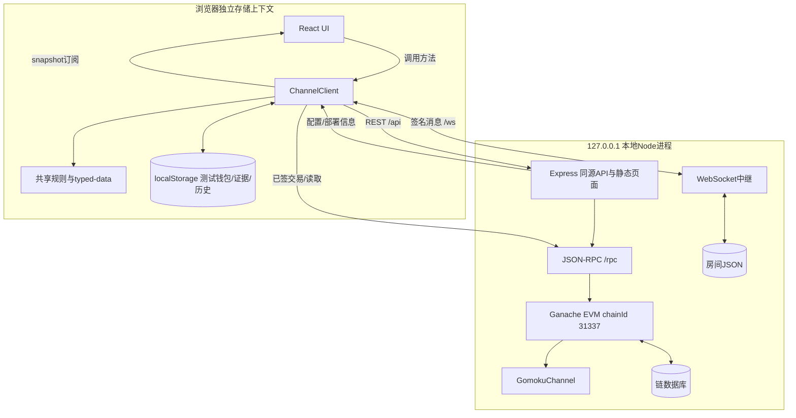
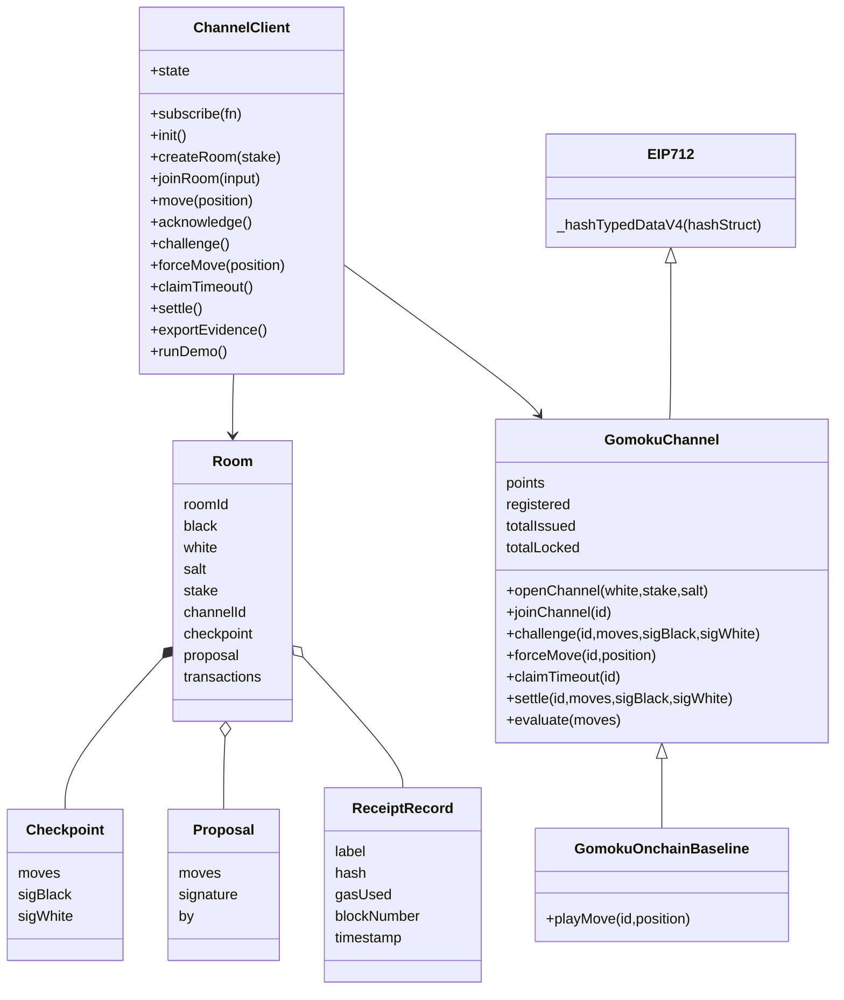
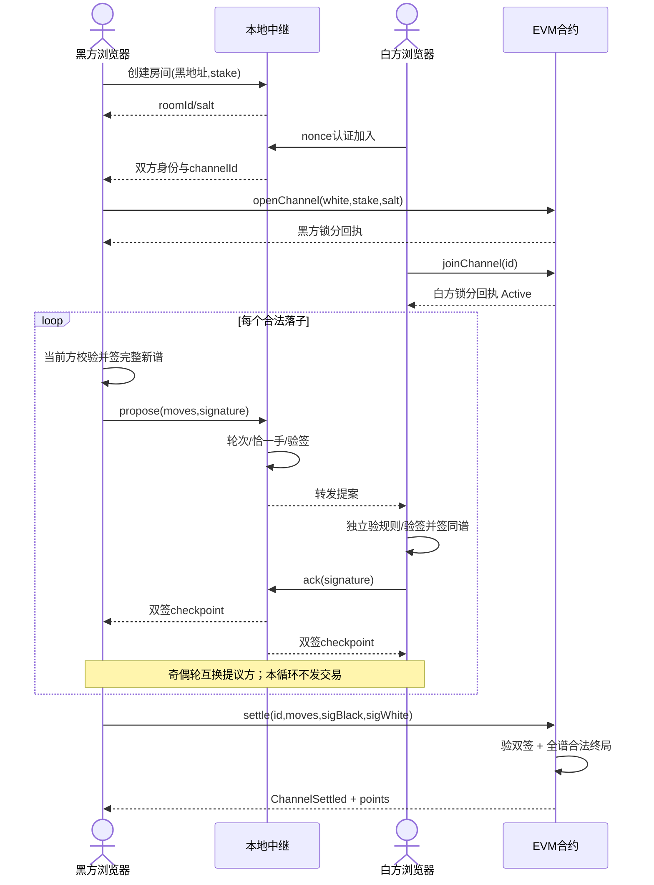
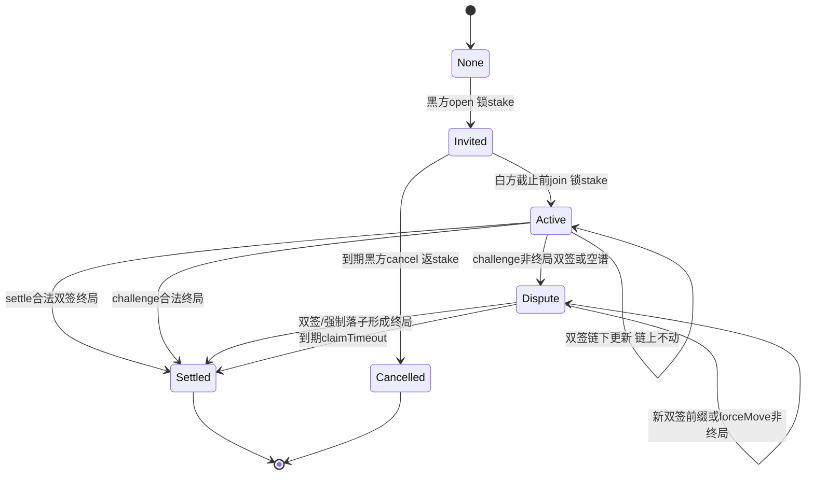
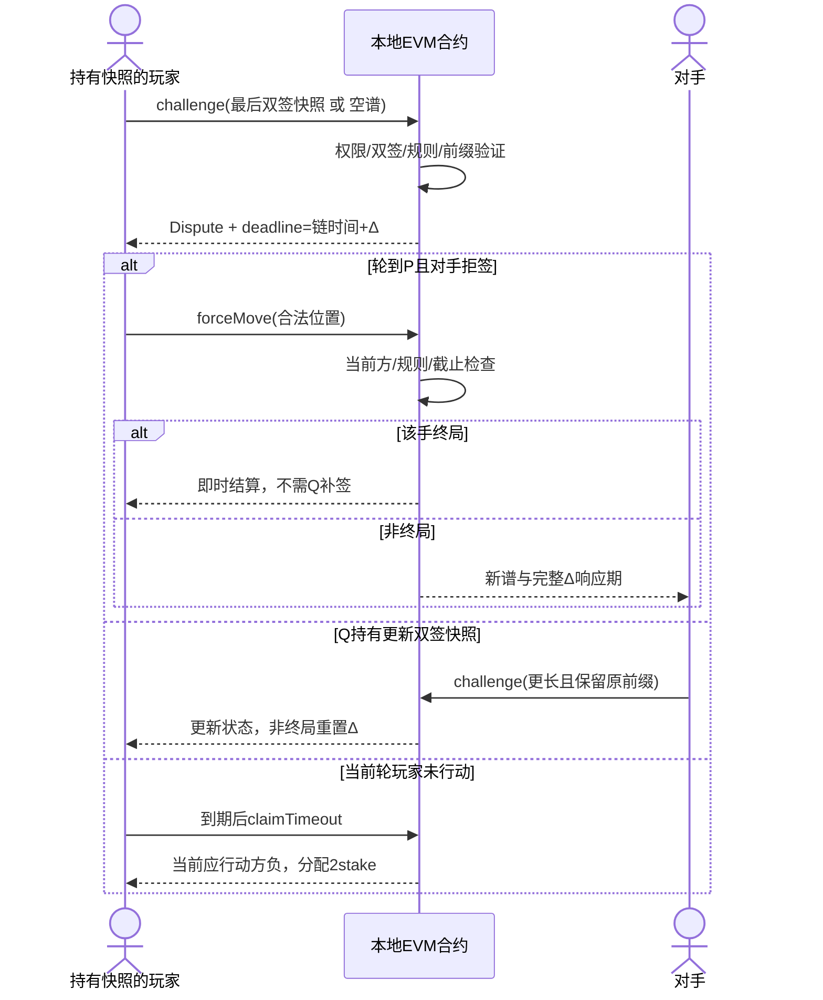
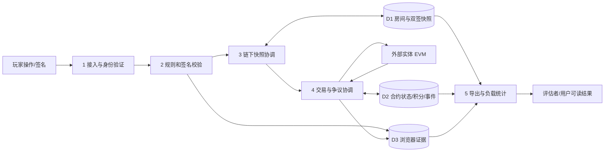
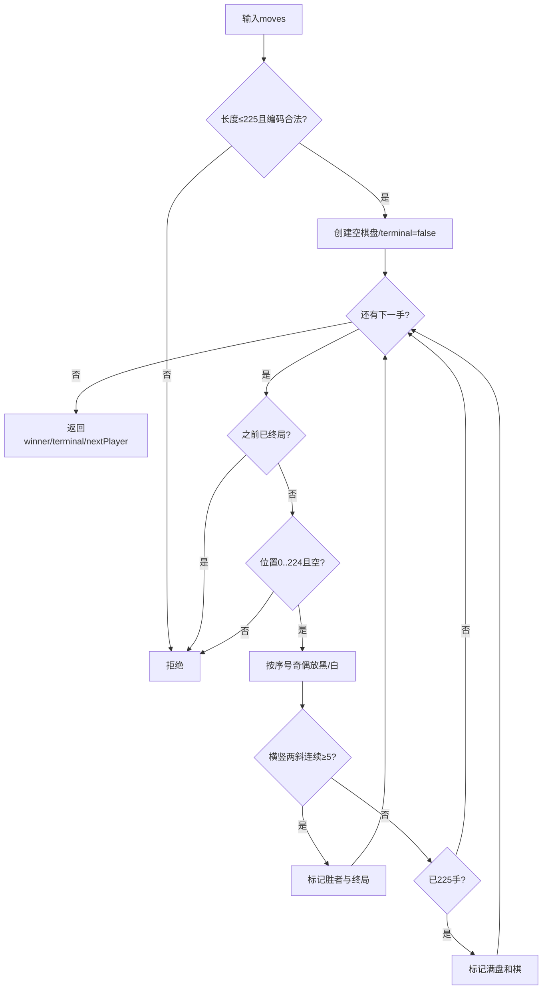

# 五子棋通道系统：架构、协议与关键设计

版本：0.1；状态：依据当前源码静态阅读形成的架构说明，不是执行验证或安全审计报告。本文作者阅读了[本地服务](../server/index.mjs)、[共享规则](../shared/gomoku.mjs)、[客户端控制器](../web/src/channel-client.js)、[证据核验](../shared/evidence.mjs)、[证据命令](../scripts/verify-evidence.mjs)、[合约](../contracts/GomokuChannel.sol)、[编译脚本](../scripts/compile.mjs)、[依赖声明](../package.json)、[协议设计](protocol-spec.md)与[Web接口](app-interface.md)。代码存在、接口设计、实际运行结果必须分别记录；已读取[合约原始结果](../artifacts/test-results/contract-results.json)的环境/11组用例段、[JS及证据结果](../artifacts/test-results/protocol-results.json)全部，以及2026-10-27T01:05:31.385Z生成的[最终浏览器结果](../artifacts/test-results/e2e-results.json)用例、拒签恢复、导入与汇总片段：8通过、0失败。本文不代替[测试报告](testing.md)，未运行场景仍不应据此标通过。

需求与课程依据见[需求规格](requirements.md)和[课程合规](course-compliance.md)，外部研究与复用边界见[研究文档](research.md)。实施持续变化时应校对本文与最终版本，不将本次阅读时的缺口冒称永久缺陷或已修复。

## 1. 架构选择与部署边界

当前采用单机教学部署：React前端经Vite构建为静态资源；Express以同一端口提供页面、REST、WebSocket和JSON-RPC代理；进程内Ganache执行真实EVM交易并持久化链数据；Solidity合约独立维护邀请、锁分、争议与结算。WebSocket中继仅协调链下双签消息，不持有玩家私钥、不决定链上积分。

| 层/文件 | 静态可确认的职责 | 需求关联 |
| --- | --- | --- |
| UI（按[Web接口](app-interface.md)约定） | 订阅snapshot，绘制15×15棋盘/双方/积分/状态/实验室/历史，调用控制器；本文未静态核验最终UI全部细节 | FR-01/06/16/21/23 |
| [ChannelClient](../web/src/channel-client.js) | 浏览器测试钱包、连接/认证中继、签名、双签快照核验、合约交易、状态订阅、导出、脚本演示 | FR-02至20 |
| [共享规则](../shared/gomoku.mjs) | 独立evaluate、前缀/恰一手扩展、bytes编码、typed-data类型、负载统计、连接认证文本 | FR-06至09/21/22 |
| [Express/WS服务](../server/index.mjs) | 本地节点/部署、配置与房间API、连接认证、提案/确认中继、回执核验、房间落盘、页面托管 | FR-02/04/08/17/18 |
| [GomokuChannel](../contracts/GomokuChannel.sol) | 注册教学积分、开通/加入/取消、双签/全谱校验、挑战/forceMove/超时、积分结算 | FR-04/05/09/11至15 |
| [GomokuOnchainBaseline](../contracts/GomokuChannel.sol) | 继承相同积分与规则，提供playMove逐步上链测量基线；代码存在不等于已实测 | FR-21/22，NFR-06/07 |
| [编译脚本](../scripts/compile.mjs) | solc 0.8.30、Shanghai、优化器200次，读取工作区依赖并导出ABI/字节码 | NFR-03/11/12 |

源码默认PORT=4173、只监听127.0.0.1；这些是配置默认值，不证明当前服务已启动或该URL可访问。Ganache默认chainId=31337、Shanghai、区块gas上限30,000,000；部署challengePeriod默认60秒（可由环境变量调整），invitePeriod=300秒。实际运行值以真实配置和链读取为准。

此模型的价值是能复现真实EVM执行、签名验证和收据；不能称其为多个独立验证者组成的生产共识网络。开发RPC含余额/时间等测试能力，本地服务和浏览器测试钱包均属于受控教学环境，禁止映射公网或导入真实资产密钥。

## 2. 领域对象、数据字典与存储

### 2.1 领域类图

下图中ChannelClient、GomokuChannel、GomokuOnchainBaseline、OpenZeppelin EIP712是源码中的类/合约；Room、Checkpoint、Proposal、ReceiptRecord为实际JSON/struct数据模型，图示不表示源码一定声明同名JavaScript class。

### 2.2 关键字段

| 名称 | 类型/值域 | 含义、来源与约束 |
| --- | --- | --- |
| position | uint8/JS整数0..224 | row×15+col；棋色由落子序号奇偶确定，不允许调用者自填棋色 |
| moves | Solidity bytes / JS number[] | 最多225项有序棋谱；每个位置只出现一次；首次终局后不能追加 |
| movesHash | bytes32 | keccak256(movesHex(moves))；完整有序谱的承诺，不仅是最终棋盘 |
| roomId/salt | 随机32字节hex | 服务创建本地房间用randomBytes生成；roomId同时作开通salt，不是人类可读短码 |
| channelId | bytes32 | keccak256(abi.encode(black,white,salt))，同合约内不可重复；白方认证后确定 |
| black/white | address | 开通/加入身份；零白方、自对弈开通被拒绝；地址不是现实身份 |
| stake | uint256；房间API限制1..1000整数 | 每方锁定教学积分；合约本身要求正数且足额，不把API上限误写成合约上限 |
| status | 0..5枚举 | None、Invited、Active、Dispute、Settled、Cancelled |
| deadline | uint256链时间秒 | Invited为加入截止；Dispute为响应截止；Active置0；终局后的字段不表示仍有活跃争议 |
| winner/reason | uint8 | winner 0和/未定、1黑、2白；reason 0未定、1五连、2满盘、3超时 |
| points/registered | address映射 | 每地址一次领取1000教学分；仅合约规则可转移可用/锁定积分 |
| totalIssued/totalLocked | uint256 | 已注册发行总量与所有未结束邀请/对局锁定总量 |
| checkpoint | moves+sigBlack+sigWhite | 双方签同一State的已确认快照；空谱可无签；单签提案不算checkpoint |
| proposal | moves+signature+by | 当前落子方签署新谱，等待另一方确认；中继每局至多一个待确认提案 |
| ReceiptRecord | JSON对象 | 真实receipt的hash/gasUsed/blockNumber及区块timestamp；同hash去重 |
| snapshot | UI对象 | ready/busy/error、身份、状态、棋谱、pending、双方签名、真实交易、metrics、历史等 |

### 2.3 数据存储与恢复

| 存储 | 当前源码行为 | 边界 |
| --- | --- | --- |
| 工作区artifacts/runtime/chain | Ganache数据库 | 本地操作者可重置；不能宣称永久外部可信归档 |
| 工作区artifacts/runtime/deployment.json | 地址、chainId、部署hash/gas、createdAt | 启动检查地址是否有code；不等同于全面验证代码hash/编译版本 |
| 工作区artifacts/runtime/rooms.json | 房间、快照、提案、交易；串行saveQueue写入 | 中继落盘方便恢复，不替代玩家自主保管签名 |
| 浏览器localStorage | 同源测试私钥、历史、active-room指针、按channelId存证据 | 私钥明文仅适用于教学；同profile同源标签共享钱包，双人需独立浏览器存储上下文 |
| 内存_checkpoint | 当前双签快照、断开WS后仍保留 | 未刷新时可直接调用链上争议；持久化证据能否在不依赖中继情况下重新加载须额外验证 |
| 用户导出JSON | format、域、参与方、stake、checkpoint、onchain、transactions、initialization、metrics、信任边界 | exportEvidence不导出私钥；importEvidence已新增，先验证双签，再核对实际链和回执 |

init先按合约地址对应的active-room重连中继；失败时读取active-channel指针与已保存evidence，调用importEvidence恢复_checkpoint并进入可直接RPC操作模式。浏览器导入会检查当前合约/chainId、参与方/stake和每笔成功回执所属本局；当前钱包非参与方时role=0可查看，不能越权操作合约。已有代码和最终浏览器回归：正常导出后刷新恢复、独立观察钱包导入双签与3笔回执、篡改包拒绝均通过。中继永久失联后init自动fallback的完整独立场景未在8项用例名中单列，不能由导入成功自动视为全部故障恢复已测；仍依赖原本地RPC在线和原钱包/证据存在，不能称为节点完全失联时可结算。

[离线核验函数](../shared/evidence.mjs)检查schema、域/地址/积分格式、棋谱、双方签名与链下/标称链上棋谱前缀关系，返回cryptographicOnly=true；[命令入口](../scripts/verify-evidence.mjs)加--rpc后额外核对chainId、合约参与方/stake、成功回执目标与通道事件，返回链核验信息。不带RPC的结果不证明链上状态真实；链下证据中的onchain字段是导出快照标签，需RPC查询才能确认，不能只信该JSON声称已结算。

## 3. 接口设计

### 3.1 HTTP与WebSocket

| 接口 | 请求/响应 | 校验与作用 |
| --- | --- | --- |
| GET /api/config | deployment、ABI、challenge/invitePeriod、networkName、pointsInitial | 浏览器构造合约/域的依据；最终积分读取仍来自合约 |
| GET /api/health | ok、chainId、contractAddress | 当前仅返回进程已有配置，不是完整RPC/bytecode/一致性诊断 |
| POST /api/faucet | address→balance、method、localOnly | checksum地址；低余额用evm_setAccountBalance直接设置本地测试币，非真实转账、不能记作“免费链上转账” |
| POST /api/rooms | address、stake→Room | 随机roomId、整数stake范围；仅创建链下房间，不直接开通链 |
| GET /api/rooms/:id | roomId/channelId→Room或404 | 获取邀请/快照；私钥不在Room中，房间号不是隐私访问控制凭据 |
| POST /rpc | 单个/批量JSON-RPC | 代理进程内Ganache；有本地开发方法，不能当生产公开RPC |
| WS /ws：hello/auth | 服务nonce；客户端address/roomId/signature | personal-sign连接认证文本绑定nonce、房间、链与合约；认证不等于State签名 |
| WS：propose | moves、当前方signature | 通道Active、无pending、恰扩展一手、当前方、正确typed-data签名 |
| WS：ack | 对方signature | 不能本人确认自己的提案；验签后形成黑白双签checkpoint并清空proposal |
| WS：sync/room | 同步请求/房间与peers广播 | peers仅是已认证连接地址，不证明真人在线 |
| WS：tx | hash | 服务读取成功回执、目标合约及本局事件后采集；不信客户端自报gas和成功 |

HTTP JSON限128KB；WS maxPayload 32768；认证超时服务端15秒。服务只监听127.0.0.1并对带Origin请求限制localhost/127.0.0.1同端口；无Origin本地程序仍可访问，这些措施不是身份隔离或XSS防御证明。任意同源恶意脚本若执行仍可能读演示私钥，勿将其描述为生产钱包托管方案。

### 3.2 合约写接口与权限

| 接口 | 可调用者/条件 | 效果 |
| --- | --- | --- |
| register | 任意未注册地址 | 一次发行1000积分；totalIssued增加 |
| openChannel | 已注册黑方、足额、白方非零非自身、新id | 锁黑stake，进入Invited，建立邀请截止 |
| joinChannel | 指定白方、已注册足额、截止前 | 锁白stake，进入Active |
| cancelUnjoined | 黑方、Invited、到期 | 返黑stake，Cancelled；白方从未锁分 |
| settle | 持有双方合法终局签名的提交者 | Active/Dispute，Dispute须前缀相容，终局则结算；源码不要求msg.sender是成员，因为支付去向由对局固定 |
| challenge | 黑/白成员 | Active或Dispute；后者须截止前、更长且前缀相容；空谱可免签；终局即时结算，否则Dispute并重置期限 |
| forceMove | Dispute中当前轮成员、截止前 | 重放追加一手是否合法；形成终局即时结算，否则重置期限 |
| claimTimeout | 黑/白成员、Dispute且到期 | 当前应行动方负，另一方获双方stake |
| evaluate/stateDigest/getChannel/points等 | 只读 | 棋谱有效性、签名摘要、真实状态与积分 |

settle未检查Dispute期限，当前源码允许有效相容的双签终局在claimTimeout之前提交，即便已过deadline；与claimTimeout同时竞争时以链上先成功执行者为准，后者因not live失败。这是实际接口语义，不能声称过deadline后所有非claim操作都必然拒绝；如需改变，应先更新协议ADR和边界测试。

## 4. 双签正常路径与状态转换

### 4.1 正常对局时序

图中循环用黑方提案示意，实际奇偶轮互换提议者。已注册玩家正常每局3笔（open、join、settle）；部署、注册、faucet开发方法分别列账。调用signTypedData产生签名，不产生EVM交易或gas回执。

### 4.2 生命周期

链下pending不是合约状态；未确认的胜棋不能直接当双签终局settle。客户端snapshot可展示“等待确认”，但不得静默推进为committed。

## 5. 争议、拒签与期限

约束：chain timestamp < deadline才能更新challenge或forceMove；>=deadline可claimTimeout。无效/同序/旧/非前缀快照不延长；有效更长状态或强制合法落子才重新给完整Δ。seq上限225，合法推进有界，避免无效消息无限拖延。仍不能保证永久离线玩家公平：玩家须在窗口内监控链并能提交交易，本项目未实现watchtower。

客户端目前state.now采用浏览器墙钟近似倒计时，合约判断采用block.timestamp。两者可能偏离；UI必须以提示方式呈现，交易是否可执行由链决定，不能把浏览器时间当共识时间。若需要精确链上倒计时，应读取最新块timestamp并标记数据新鲜度。

## 6. 数据流与关键算法

### 6.1 顶层/分解数据流

DFD描述数据变换和存储；D2真实存在于合约，不是服务可直接改写的数据库。用户提供的棋谱必须经过规则/签名两条校验，不能从UI输入直接进入积分更新。

### 6.2 合法落子与完整棋谱验证

JS规则函数返回board、winner、terminal、winningLine、nextPlayer；Solidity返回winner/terminal。合约每手检查四个方向、每侧最多延伸4格即可判定是否存在≥5连；前端可延伸更长以展示获胜线。225格与方向扫描上界固定，因此完整验证成本随棋谱长度线性增长且有界；实际gas仍必须用真实交易测量，不能由算法阶数推算通过。

### 6.3 签名摘要与防重放

源码类型为State(bytes32 channelId,bytes32 movesHash)。结构hash采用keccak256(abi.encode(STATE_TYPEHASH,id,keccak256(moves)))，再由OpenZeppelin _hashTypedDataV4加入域。链下ethers采用同域/同类型signTypedData与verifyTypedData。链/合约/版本隔离、唯一channelId、棋谱前缀与生命周期共同限制重放；单凭EIP-712标准不自动提供业务重放保护。

当前无独立部署纪元/domain salt。人为重建相同chainId、同地址并恢复同一channelId时，域可能相同；新随机salt与实例隔离是运行约束，不能称为密码学跨重建保证。需要更强保证时应升级域或消息，旧签名与兼容策略一起评审。

### 6.4 积分守恒与交易负载

注册使totalIssued增加1000；open/join把可用points转入totalLocked；cancel退还已锁黑方；finish把双方2stake全部返还/分给胜者并减totalLocked。对已知已注册地址集合应满足：sum(points)+totalLocked=totalIssued。合约无ETH存取或外部资产支付调用，演示gas用独立的本地测试ETH。

metrics采用baselineTransactions=moves.length+2（m>0），onchainTransactions=transactions.length，savedPercent=(1-actual/baseline)×100，totalGas为所列回执gasUsed之和。该m+2是同open/join并最后一步自动结算的逐步上链模型；m=0时基线与比例置0以防除零。未终局时只能称“当前快照对照”；争议谱里含链上forceMove，当前字段offchainMoves仍简单等于moves.length，不能据此断言所有手都发生链下。

本次阅读时transactions只采集客户端成功回执/中继已验证成功回执；已广播但失败交易并未见独立失败账本。需求FR-22要求失败交易另计，最终报告应补实测原始记录，或明确图表仅含成功交易。基线合约已定义但是否部署/测量、相同棋谱gas数据均以测试证据为准。不能由交易数降幅直接推导gas、延迟或TPS提升。

## 7. 关键架构决策（ADR）

下列状态为“现有源码已采用的设计，核心合约11组、JS/证据4组、浏览器8组场景已有原始通过记录”，不是教师审批或独立安全审计结论。

### ADR-001：完整棋谱双签，复用OpenZeppelin密码组件

背景：课程要求减少事务又能正确结算。仅由中心服务器判胜难以独立核验；每步上链增加事务；只提交最终棋盘hash无法直接证明落子合法。

决策：当前方每步签完整新棋谱，对手独立验证再签；结算和挑战一次提交最终/最新双签快照，合约完整重放规则。EIP-712结构化域与ECDSA恢复复用OpenZeppelin，浏览器签名/ABI/RPC复用ethers。应用专用协议、前缀检查、规则、积分与界面自主实现。

取舍：最多225字节棋谱传输简单且便于课堂解释，不引入零知识证明/通用通道框架；合约验证成本随m增长，须验证最长合法局gas。双签可能被拒绝，因此必须有challenge+forceMove，不能把“双方必须合作”当安全假设。最新快照证明对完整棋谱的共同授权，并不等于导出包包含每个历史版本独立的全部签名。

验证：前后端同向量digest、错域/错签人/棋谱篡改、非法但双签谱、终局后追加、最长合法谱、重复结算；证据未提供前不标通过。

### ADR-002：注册发行的教学积分与stake锁定

背景：需要实际链上积分结算但不需要真实经济资产，用户明确禁止未经授权产生真实费用。

决策：每地址一次领取1000演示积分，双方各锁stake，胜者获2stake、和棋返还；积分与测试ETH区分。totalIssued/totalLocked支持守恒验证，不实现兑换、转账市场或真实资产存取。

取舍：匿名地址可无限创建，无法防女巫/串谋刷分，积分不能当真实身份信誉；教学流程更易复现。未加入邀请必须能超时退款，避免黑方分数永久锁定。

验证：注册仅一次、余额不足拒绝、邀请取消、胜负/和棋/超时释放、重复调用、sum(points)+totalLocked守恒。

### ADR-003：争议以有效推进重置响应期，并允许本人强制落子

背景：对手可能拒签，尤其最后一手获胜时；仅挑战双签终局无法处理。若新状态在期限末改变轮次却沿用原截止，会导致新轮次方没有响应时间。

决策：challenge接受最新有效双签前缀或初始空谱；Dispute中的新快照必须更长且兼容；当前方可forceMove，合法非终局推进都重置完整响应期，终局即时结算。到期当前应行动方负。

取舍：恶意方可把后续合法对局变成多笔链上操作；推进最多225步但并非恒定3笔。诚实方须监控链且能在期内提交，首版无watchtower。settle与超时的链上执行顺序语义须保留并测试，不凭浏览器倒计时判断不可变结果。

验证：初始空谱挑战、旧状态修正、非前缀拒绝、错误轮次forceMove、胜棋拒签、deadline-1/deadline/deadline+1、有效推进重置期、已结算拒绝。

## 8. 已核验记录范围与后续边界

最终[浏览器结果](../artifacts/test-results/e2e-results.json)8组通过、0失败，覆盖独立上下文钱包/225点棋盘、邀请开通、9手双签而仅2笔开通、终局结算/积分/导出/刷新、拒签胜棋救济、明确脚本身份的自动演示、观察钱包导入/篡改拒绝、390像素移动宽度无横向溢出。拒签场景实际持有8手双签checkpoint，第9手用forceMove形成黑胜，4笔为open+join+challenge+forceMove，总gas=619199；这是单个本地场景，不外推为所有争议恒定4笔。自动演示9手3笔，总gas=431699；与合约对照测试不同运行实例，不混用其gas数字。

| 项目 | 本次阅读能确认 | 不能据此宣称 |
| --- | --- | --- |
| 真实EVM闭环 | 源码使用Ganache/真实receipt；已读合约结果11组均passed，JS/证据结果4组passed | 未运行场景也已通过、未读原始数据也已核验；这些结果不等于第三方审计 |
| 双签与规则 | 客户端/中继/合约各有对应验证逻辑 | 独立安全审计或生产级无漏洞 |
| 导出/导入 | JS/证据结果4组通过；最终E2E8/0含观察钱包双签+3回执导入、禁用越权动作、篡改拒绝 | 未测证据格式/攻击全部已覆盖；永久失联自动fallback完整场景已单独测试 |
| 恢复 | 浏览器存证据/active-channel，relay恢复失败时有直链恢复代码 | RPC/节点失联时仍能结算；证据丢失也可保证恢复 |
| 时间 | 合约block.timestamp约束 | UI墙钟与链时间完全相同 |
| 交易统计 | 成功交易hash去重和gas相加 | 所有失败广播已纳入、所有moves都链下、基线gas已测 |
| 双人 | 不同地址、nonce认证、房间两方校验 | 同profile两标签天然是不同玩家、脚本演示为两位真人 |
| 发布反馈 | 可以托管本地构建页 | 已公开发布、保留1个月、真实用户已试用 |

后续测试/实现修复上述缺口后应补真实版本、证据路径与结论，并更新[需求规格](requirements.md)状态。本文作者只撰写文档，未改变源码、部署或测试环境。
