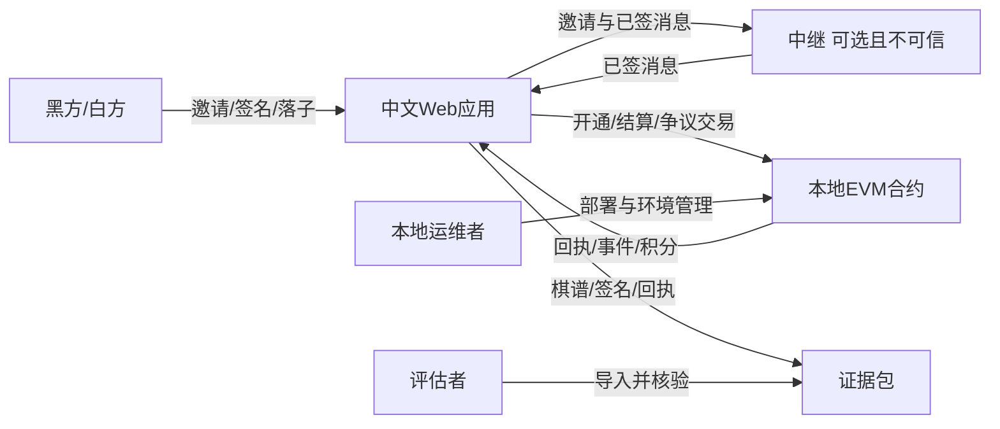
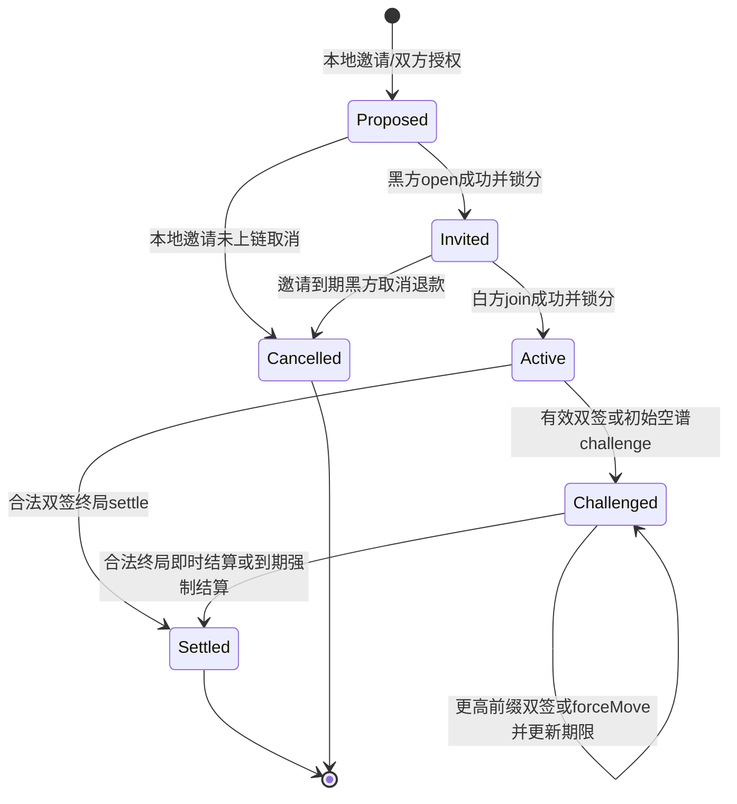
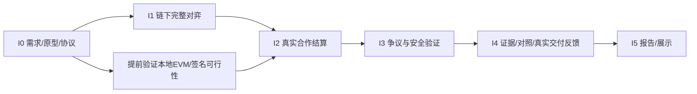

# 中文Web五子棋与链下通道：需求规格与实施计划

版本：0.2；状态：拟定需求基线，尚不代表实现或测试通过。依据：用户项目方向、[工作区规则](../AGENTS.md)、四份PPT及教案/报告模板，另选择性阅读两份PDF范文的目录/测试/总结片段；来源与评分冲突详见[课程合规文档](course-compliance.md)。实现接口以[协议设计v1](protocol-spec.md)与[Web接口v1](app-interface.md)校准。所有工时、性能、交易预算及反馈人数均为计划目标；本文没有软件运行、链上交易或访谈结果。

## 1. 产品定义、目标与范围

产品定位：为课程演示与轻量对弈提供中文、视觉精致、规则清楚的Web五子棋，用真实本地EVM合约记录积分，以每步链下EIP-712签名减少正常对局上链次数，同时提供争议超时退出、可核验证据与交易负载对照。

| 业务编号 | 目标 | 成功判据/证据 |
| --- | --- | --- |
| BR-01 | 可以顺畅完成真实双人五子棋 | 两个不同参与方完成合法对局；客户端规则、棋谱和合约结果一致 |
| BR-02 | 积分具有可验证的结算来源 | 本地EVM真实回执、合约积分读取、事件可追溯；重复结算无效 |
| BR-03 | 降低正常对局对底层链的事务负担 | 实际正常路径交易与链下落子数分别计数；对照每步上链基线并公开统计口径 |
| BR-04 | 对手不合作时有明确退出路径 | 本地链真实执行挑战、响应、期限前拒绝及到期强制结算 |
| BR-05 | 让非区块链用户理解可信来源与代价 | 中文状态解释、签名/交易区别、证据导出、真实用户试用反馈 |
| BR-06 | 形成可复核课程工程成果 | 可追踪需求、设计、版本、原始测试、≥30项WBS、实际发布和反馈证据 |

P0必须交付：完整中文交互、真实本地链/合约、双人落子与签名、合作结算、争议超时、积分、证据、负载对照、基本恢复、运行说明与安全验证。P1期望：扩展的棋谱回放、可用性改善、更多异常演示、自动化性能采样。P2延后：AI棋手、公开匹配、跨设备互联网对战、锦标赛、排行榜反作弊、观察者实时推送。

明确边界：15×15自由五子棋；黑先，横/竖/两斜任意连续至少5子获胜，无禁手/交换开局；225格满且无胜为和棋。积分为不可兑换、不可转让的演示统计，不接入真实资产、不发行可交易代币。默认仅本地测试链，未授权不部署公网链。首版不承诺多人并发规模、生产级可用性、恶意双方串谋防护或独立共识网络安全。游戏AI（如增加）与开发辅助AI是不同概念，不能混写。

## 2. NABCD与需求来源

| 维度 | 项目分析 | 待验证假设与证据方法 |
| --- | --- | --- |
| N：Need | 核心需求是假设：用户希望对弈顺畅，并能解释积分为何可信；每步等待链确认会破坏节奏，单纯中心化积分又难以自行核验。目标首先是课程同学、休闲棋类用户及想理解通道的学习者 | 尚无访谈。让真实试用者完成落子/结算任务，观察是否理解签名、交易和积分来源；避免把课程要求直接写成已证实市场需求 |
| A：Approach | 前端中文棋盘；每步本地规则校验与EIP-712签名；必要中继仅传消息；开通/结束少量链上交易；合约验证与积分；争议期响应/超时；证据包与可视化 | 以规则单元、协议反例、本地EVM集成和双窗口系统测试验证；先验证安全闭环再扩充玩法 |
| B：Benefit | 正常落子无需逐步链确认；对局可追溯；单方拒绝继续仍有退出机制；用可视化帮助理解链下与链上成本 | 分开测点击响应、签名耗时、交易次数及gas；用户是否读懂界面由真实任务反馈判断。收益不写成已达成百分比 |
| C：Competitors | 比较三类替代方案：中心化在线五子棋、每步上链游戏、签名通道游戏。前者体验成熟但依赖服务方记分；逐步上链易核验但交易多；通道复杂且要求保存状态并监控争议 | 本文未实测具体商业产品，以上为架构比较。后续具体竞品须记录官网/仓库URL、访问日、许可证/版本、截图与实测范围；不编造产品缺陷或用户量 |
| D：Delivery | 准备公开介绍/下载/源码页，提供截图、真实获取路径、中文启动说明、演示视频；用户下载后可在自己机器运行本地EVM；课堂8分钟展示并收集真实反馈 | 公开页至少保留1个月是课程要求。静态页和本地完整链演示的差别须标明；上线时间/地址/保留期限等真实发布后填写，当前未声称已发布 |

需求来源编号：SRC-01课程教案选题3（正确结算、降低负载）；SRC-02课程过程与报告要求（见合规文档）；SRC-03用户指示（中文Web、EVM、Solidity、EIP-712、争议、证据、可视化）；SRC-04工作区与真实性约束；SRC-05后续真实用户反馈（当前无记录，不能作为现有证据）。

## 3. 角色、系统边界与用例

| 角色 | 权限与目标 | 信任边界 |
| --- | --- | --- |
| 玩家A/黑方、玩家B/白方 | 各自同意开局、仅签自己落子、查看证据、合作或发起争议/响应/到期结算 | 两地址必须不同；每方可能离线、拒签、发送非法/旧数据；本人双账户演示仅为系统测试 |
| 评估者/试用者 | 查看说明、获取软件、验证导出、理解交易与反馈 | 非对局参与者不具备落子或改分权限 |
| 本地运维者（本人） | 启停节点、部署、环境检查、保存测试数据 | 本地节点控制者可重置链，因此不能称为公网上不可篡改共识；运行目录和配置受工作区约束 |
| 钱包/演示签名器 | 显示授权内容、签名、发送允许的本地交易 | 钱包拒绝、账户变更、错误链均须显式处理；内置演示密钥不可用于真实链 |
| 消息中继（若采用） | 传递邀请、落子、签名与状态 | 不拥有用户签名权和积分权；可能丢包、重排、审查或离线，不能作为最终裁判 |
| EVM合约 | 验证开通授权、状态/证据、争议时限与结算、维护积分 | 只信合约规则与有效证明，不能信UI传来的胜者；不保证现实身份或双方没有串谋 |

图为系统上下文，不替代后续UML用例图和部署设计。

| 用例 | 主角色 | 前置→主成功场景→结果 | 异常/关联需求 |
| --- | --- | --- | --- |
| UC-01 了解和配置 | 玩家/评估者 | 阅读说明→检查本地节点与链/合约→选择本地账户→就绪 | 节点不可达/错链阻止交易；FR-01/02/03 |
| UC-02 创建与加入 | 两玩家 | 不同地址、明确stake/规则→注册有余额→黑open/白join均成功并锁分→Active | 同地址/余额不足/重复ID/未确认不可开始；未加入到期退款；FR-04/05 |
| UC-03 链下对弈 | 两玩家 | 合法当前状态→当前方选空格签新完整谱→对方验证并签同谱→双签保存并更新轮次 | 越界、占位、错序、丢包、拒签均不提交为committed；FR-06至10 |
| UC-04 合作结算 | 两玩家 | 合法终局且完整双签→提交真实settle→按胜负/和棋释放锁分 | 交易失败不能显示已结算；首版无提前认输/合意和棋；FR-11/12/17 |
| UC-05 非合作退出 | 任一玩家 | 有双签快照/空谱→challenge→更高前缀快照或本人forceMove→终局即时/非终局到期结算 | 旧状态、前缀、最后一手拒签、期限边界；FR-13至16 |
| UC-06 查看与恢复 | 玩家 | 保存证据→刷新/重连→读取链状态并校验本地签名→恢复同一棋局 | 无可信本地最新状态须提示风险，不能自动造状态；FR-10/18 |
| UC-07 导出核验 | 玩家/评估者 | 对局或结算证据→导出→重新导入校验→显示每项结果与限制 | 篡改、缺失RPC、链重置分别说明；FR-19/20 |
| UC-08 比较负载 | 评估者 | 选择同局→查看真实交易和假设基线→读取统计定义与原始回执 | 无数据时空状态，不填示意数冒充实测；FR-21/22 |
| UC-09 获取与反馈 | 真实用户 | 真实获取软件→完成任务→自愿反馈→形成问题与迭代 | 未发布/无人试用如实记缺口；FR-23/24 |

## 4. 领域规则、数据与通道安全约束

### 4.1 数据字典与权威来源

| 数据对象 | 必备内容与约束 | 权威/用途 |
| --- | --- | --- |
| Deployment | chainId、合约地址、协议版本、部署交易、运行实例标识 | 真实RPC与构建记录；本地链重置后隔离旧实例证据；v1无独立EIP-712域salt，限制见4.2 |
| Game | channelId（本文gameId同义）、黑白地址、stake、salt、状态、deadline | id由双方地址及salt派生，单合约内唯一；Invited时黑方已锁分，白方加入后Active |
| Move | position=row×15+col（0..224）；顺序bytes棋谱中的一项 | seq=棋谱长度，最多225；当前方提出扩展恰一手的新谱 |
| State | 完整moves、movesHash、双方签名、下一方、终局/胜者 | EIP-712 State(channelId,movesHash)，每步双方独立校验并签同一完整棋谱；合约重放判结果 |
| PendingProposal | 新谱、提议方签名、待对方确认标志 | 单签提案不是已提交快照，不能覆盖已双签棋谱；对方拒签时可转链上forceMove |
| Challenge | 已验证moves、序号、发起时间、链上deadline、当前应落子方 | 合约时间与状态为准；challenge接收更高且有原前缀的双签快照，forceMove为本人链上落子 |
| Settlement | 结果原因、stake分配、参与方、channelId、交易、事件 | 合约事件/points读取；一次性释放锁定积分并记账 |
| Evidence | schemaVersion、域/规则、授权、完整moves/签名、交易与回执、导出环境 | 便于本地复核；不包含任何私钥/助记词或用户联系方式 |

### 4.2 EIP-712与状态有效性

安全基线是需求，不是现有代码事实；实现若采用等价协议，应通过ADR明确映射和重新评审验收。

1. v1 EIP-712域为name=GomokuChannel、version=1、chainId、verifyingContract。消息为State(bytes32 channelId,bytes32 movesHash)，movesHash=keccak256(moves)。字段/类型/编码须在客户端与合约一致。channelId绑定参与方与随机salt，完整谱绑定序号、坐标和前缀；无需另签孤立坐标或未绑定链的字符串。
2. 每一步当前方提出恰扩展一手的完整新谱并签名，另一方验签/验规则后签相同新谱；仅双签快照视为committed。当前方单签但对方拒绝确认时，保留旧快照并通过challenge+forceMove救济，不伪造对方签名。
3. moves为有序position bytes，每项row×15+col；规范hash避免不稳定JSON序列化。每步验证长度+1、轮次、边界、占位、旧谱前缀与终局；序号等于长度且≤225，终局后不可继续落子。
4. 合约settle/challenge均重放完整有效棋谱，不能仅验双方签名就信任winner。即使双方有有效签名，非法谱仍拒绝；但合法对局也不能证明双方没有串谋刷积分。
5. 空谱仅在已共同加入的Active对局可作为无签名初始挑战。中继无权代签、改棋谱或判胜；提案/待对方签/已双签/已上链状态明确区分，解析异常不得覆盖已验证快照。
6. lifecycle、参与权限、邀请期限/余额、严格前缀更新、结算幂等需由合约执行；同局重复请求、其他局/链/合约签名均无效。邀请取消须仅黑方、未加入、超过邀请期，释放黑方锁分。
7. v1域不含独立部署纪元：若人为重建完全相同chainId、合约地址并重建同一channelId，不能声称密码学上阻止所有旧签名复用。运行管理应使用新salt、新实例证据目录和前端部署识别隔离旧数据；若要求强跨重建抗重放，需新增域salt/纪元并升级协议。该限制必须记录，不把前端隔离当合约密码学证明。

### 4.3 生命周期与争议语义

协议v1：双方加入后，任一参与方可提交最新有效双签棋谱发起challenge；初始空谱可免签。Dispute内更新须更长且已存棋谱为其前缀，不能接受降低/同序号/非前缀分支；当前轮玩家可用本人交易forceMove追加一手，解决对手拒签尤其最后一手胜棋拒签的问题。有效终局快照或forceMove形成五连/满盘时即时结算；未终局建立/更新争议期。Dispute中的settle也不得回退或采用不兼容棋谱。合约状态不因中继报告而改变。

设合约保存deadline，挑战期Δ为开通规则的一部分，本地演示可用短期值但必须显示实际值。时间规则：链时间t < deadline允许更新；t >= deadline允许强制结算。有效更高序号更新后为下一响应方保留完整Δ（例如重设deadline=t+Δ）；仅重复提交/无效证据不得延长。seq最多225，合法推进有限，避免无限无效拖延。不能接受最后一刻改变轮次却不给新轮次玩家响应时间的实现。链时间推进工具仅用于明确标记的本地测试，不当作现实等待结果。

到期判定表：

| 候选状态 | 到期结果 | 积分依据 |
| --- | --- | --- |
| 已形成合法五连终局 | v1接收有效终局时即结算，无需再等到期 | 胜者获得双方锁定积分 |
| 棋盘满且无五连 | v1接收有效满盘时即和棋结算 | 各返stake |
| 未终局、轮到某方且该方未在期限内响应 | 当前应行动方超时负，另一方胜 | 超时胜负策略；界面说明属于超时结果 |
| 非法签名/非法棋盘/无效gameId | 交易拒绝，不建立/改写候选 | 无变化 |
| 已结算 | 后续请求拒绝或明确无操作，不重复加分 | 无变化 |

协议v1积分策略：每地址可自行注册领取1000个无现实价值的演示积分，每局双方各锁定stake；正常胜或超时胜者获得2×stake，和棋双方各返stake；未加入邀请超时取消返还黑方锁定额。积分不涉及ETH充值提现，注册发行与对局资金流分列；可用余额+活动局锁定额的总量相对注册发行量守恒。注册存在女巫攻击，不把该积分称为真实竞技信誉。若实现调整，须版本化并在开通前展示，更新测试；不得让管理员或客户端任意覆盖历史对局积分。协议v1仅允许合法棋盘自然终局的合作结算，提前认输/约定和棋暂不在首版；后续若加入，须另立专用授权类型与版本评审。

信任/公平性限制：玩家须保存可用最新证据，并在争议期内主动上线检查；首版无24小时watchtower。恶意方可强制进入链上流程而增加gas，正常路径少交易不涵盖攻击成本。节点停机不能保证按墙钟到期结算；节点控制者重置链会失去原实例结算证据。签名证明地址授权，不证明真实身份、独立用户或没有串谋刷分；首版积分不作为可信竞技排名。

## 5. 功能需求与可观察验收标准

表内均为“系统应”，当前状态统一为拟定/未验证。P0为必需，P1为增强。验收编号AC-Fxx与FR-xx一一对应，后续测试可追加子号。

| 编号/优先级 | 功能与来源/目标 | 验收标准 |
| --- | --- | --- |
| FR-01 P0 | 中文首页、规则与流程指引；SRC-03/BR-05 | AC-F01：首次访问可找到开始对局、规则、积分说明、链状态和证据入口；状态/错误用中文解释，提供本地演示身份说明 |
| FR-02 P0 | 真实链连接与健康检查；SRC-01/BR-02 | AC-F02：RPC可达且chainId、部署合约匹配才允许链上操作；节点关闭/错误链/无代码地址时阻止发送并显示原因；健康状态来自真实读取 |
| FR-03 P0 | 本地账户与签名授权；SRC-03/BR-02 | AC-F03：展示当前地址和仅限本地测试提示；两玩家地址不同；拒签、切换账户或切换链后原操作停止且不伪造成功 |
| FR-04 P0 | 注册、邀请与参数确认；SRC-03/BR-01 | AC-F04：每地址最多注册领取一次1000分；开局前查看黑白地址、stake、规则、邀请/争议期；不足额/相同地址/重复ID拒绝；未加入邀请到期仅黑方可取消并退锁分 |
| FR-05 P0 | 合约开通并加入对局；SRC-01/BR-02 | AC-F05：黑open和白join产生真实交易并分别锁stake，白方加入后才Active；读取唯一channelId及不可变参数；pending/revert不可标为开局成功；已注册玩家正常open+join+settle=3笔 |
| FR-06 P0 | 棋盘落子与规则；SRC-03/BR-01 | AC-F06：15×15、黑先、轮流、任一方向≥5获胜；越界/占位/越权/终局后落子均拒绝且seq不变；满盘无胜为和棋 |
| FR-07 P0 | 每步EIP-712完整棋谱双签；SRC-03/BR-02 | AC-F07：每个committed新谱具有黑白双方State(channelId,movesHash)签名；篡改棋谱、错签人/链/合约/局均失败；v1跨完全相同链重建的限制须说明 |
| FR-08 P0 | 对端验证与同步；SRC-03/BR-01 | AC-F08：接收方独立验签并确认恰扩展一手、轮次/占位/前缀后签同谱；非前缀/跳步拒绝；重复消息不重复落子；单签pending与双签committed清楚区分 |
| FR-09 P0 | 完整状态有效性；SRC-01/BR-02 | AC-F09：客户端与合约针对同一棋谱给出一致结果；即使签名正确，非法顺序、轮次、占位、伪造winner、终局后追加也在链上拒绝 |
| FR-10 P0 | 本地持久化与提交状态；SRC-03/BR-04 | AC-F10：已验证棋谱和签名刷新后可读取；待签/待发送/已验/已上链区分；存储失败有提示；不把尚未收到的对方签名补造为完整证据 |
| FR-11 P0 | 合作终局结算；SRC-01/BR-02 | AC-F11：合法五连/满盘且双方快照签名可settle；非终局合作settle拒绝；Dispute中不回退或使用不相容谱；UI以回执和读取为准 |
| FR-12 P0 | 链上锁分、释放与幂等；SRC-01/BR-02 | AC-F12：open扣黑stake、join扣白stake，胜者获2stake、和棋各返stake；取消邀请只返已锁黑stake；注册外总可用+锁定积分守恒，重复结算不改余额 |
| FR-13 P0 | 发起挑战；SRC-03/BR-04 | AC-F13：仅成员可用有效双签快照或初始空谱challenge；非终局生成seq/deadline，终局即时结算；非法证据/越权拒绝 |
| FR-14 P0 | 更新快照或强制落子；SRC-03/BR-04 | AC-F14：t<deadline时更长且原谱为前缀的双签快照可更新；仅当前方可forceMove合法一手；低/同序/非前缀拒绝；有效非终局推进重置完整响应期，终局即时结算 |
| FR-15 P0 | 超时强制结算；SRC-03/BR-04 | AC-F15：t<deadline拒绝claimTimeout，t>=deadline仅成员可调用且当前应落子方超时负；无需对手签名，胜者获2stake一次；已终局由对应交易即时结算 |
| FR-16 P0 | 争议提示与链时间；SRC-03/BR-05 | AC-F16：展示候选seq、轮次、剩余期、可执行动作与监控义务；浏览器改时间不改变合约授权；节点不可达时不显示确定可结算 |
| FR-17 P0 | 交易生命周期与错误恢复；SRC-03/BR-02 | AC-F17：待授权/已发送/待确认/成功/失败区分，提供真实txHash；重复点击不形成重复积分；拒签/revert/RPC断连允许安全重试或重新读取 |
| FR-18 P0 | 重连与链重置识别；SRC-03/BR-04 | AC-F18：刷新后核对链上状态、部署实例与本地证据；重置链或部署变化时隔离旧状态，不把旧交易标当前有效；中继离线仍可使用证据发起链上退出 |
| FR-19 P0 | 结构化证据导出；SRC-03/BR-05 | AC-F19：可导出含schema、EIP-712域、规则、完整棋谱与黑白快照签名、真实交易/回执、结果和统计口径的数据；不含私钥/助记词；初始化/每局交易缺失明确标出 |
| FR-20 P0 | 证据导入验证；SRC-03/BR-05 | AC-F20：重新导入可重算双方快照签名、movesHash、棋局规则和结果；有RPC时核对回执/事件/合约；无RPC只显示链下校验并标链上未核验；篡改包出现具体失败项 |
| FR-21 P0 | 交易负载对照可视化；SRC-01/BR-03 | AC-F21：同局显示链下步数、正常/争议实际交易数与每步上链基线；实际计数可追到回执；估算明确标注，空数据不显示“节省已达成” |
| FR-22 P0 | 数据口径与gas明细；SRC-01/BR-03 | AC-F22：展示部署/准备/开通/结束/争议分类、成功与失败交易、gasUsed及单位；比较基线有同口径或明确假设；不得将交易数降幅写成TPS/gas降幅 |
| FR-23 P0 | 软件介绍与准确获取方法；SRC-02/BR-06 | AC-F23：介绍页含真实截图、规则、环境、启动/下载/源码入口、本地链边界；正式发布后从独立用户环境核实真实地址与获取方法；保留1个月有安排与记录 |
| FR-24 P0 | 真实反馈与追踪；SRC-02/BR-06 | AC-F24：有真实自愿用户试用记录才填已完成；每条意见关联版本、任务、证据、需求/缺陷及处理；无人试用保留缺口，AI模拟不算 |
| FR-25 P1 | 棋谱逐步回放；SRC-03/BR-05 | AC-F25：上一/下一步和最终棋盘可重建，显示序号与签名者；回放不发送交易、不改积分；非法导入先阻止播放 |
| FR-26 P1 | 多路径演示引导；SRC-02/BR-06 | AC-F26：说明合作胜负、和棋、拒绝合作、旧状态挑战、到期退出的真实操作步骤；测试专用时间推进显式标识且仅允许本地环境 |
| FR-27 P0 | 人机对弈（迭代2新增）；见 `iteration-2-plan.md` | AC-F27：AI 为独立本地钱包；每手人与 AI 均对完整棋谱做 EIP-712 签名；对局为 open+join+settle 共 3 笔；终局可链上结算且积分守恒。最终 Docker 实测：23 手人机局 3 笔交易，结算后 1010/990（`e2e-v2-results.json`） |
| FR-28 P1 | 复盘（迭代2新增，部分实现 FR-25） | AC-F28：滑块、上一手/下一手、首尾跳转、自动播放；回看第 k 手的棋子数等于 k；回看不产生交易。已测。**与 FR-25 的差距**：复盘显示手序号与落子方，尚未显示每手的签名者，FR-25 不标为完成 |
| FR-29 P1 | 形势曲线与落子点评（迭代2新增） | AC-F29：`evaluationCurve` 长度等于手数；连五后绝对值为 1；点评文字来自共享分析器。曲线与点评的单元测试在 `ai.test.mjs`；界面渲染仅经 E2E 间接覆盖，未单独断言曲线数值 |
| FR-30 P2 | 威胁标记与提示（迭代2新增） | AC-F30：提示给出 1 至 3 个空位建议且不发送交易（E2E 已测）；终局后无提示。威胁标记 E2E 将终局前一手的成五点与共享分析器比较，并断言复盘棋盘只读 |
| FR-31 P1 | 对局证书导出（迭代2新增） | AC-F31：证书由已核验证据生成，不含私钥、脚本；篡改证据生成时抛错。单元测试 9 项通过；最终 E2E 从对局记录导出 SVG（12570 字节），渲染 PNG 已目测。交易、积分明确标注文件自述，证书不证明链上结算 |

## 6. 非功能需求与验收标准

性能指标为暂定目标，执行前记录机器CPU/内存、浏览器、Node/EVM版本、chainId、网络、采样脚本及数据。未测不填通过；必要时根据真实数据变更需求而非篡改结果。

| 编号/优先级 | 质量属性 | 验收标准 |
| --- | --- | --- |
| NFR-01 P0 | 安全：签名与授权 | 覆盖错签人、棋谱篡改、错域、跨局/跨链/跨合约、旧/非前缀状态；相应边界拒绝且不错误改分；本地链重建前端隔离与密码学域限制分别记录，不声称v1具独立纪元 |
| NFR-02 P0 | 安全：状态与结算不变量 | 合法序列≤225、仅新空格、黑白交替、终局不可追加；gameId仅结算一次；注册发行量=可用余额+未结束锁分，结算释放守恒；合约不得信前端winner |
| NFR-03 P0 | 可复现与环境隔离 | 从锁定版本按说明在E:\Gomoku内安装/构建/启动/测试；缓存、临时、日志、链数据均在工作区；不安装全局、不改系统、不写区外；保留实际命令与原始结果 |
| NFR-04 P0 | 易用与中文表达 | 首页到开局/证据/规则入口可直接找到；中文说明签名与交易区别、超时义务；真实试用目标≥3人（目标非成绩）；报告实际人数/成功任务数/阻塞而非预设满意率 |
| NFR-05 P0 | 交互性能 | 本地环境，预热后100次合法操作采样，点击至视觉反馈P95目标≤100ms；签名等待/网络往返/链确认单独测量，不计入纯渲染指标或虚构排除异常 |
| NFR-06 P0 | 交易负载 | 正常双签落子不发交易，已注册玩家每局open+join+settle=3笔成功交易；部署/注册另计；逐步上链基线若最后落子即结算为m+2笔（同open/join）；未实测基线标估算；争议/失败另计并附回执 |
| NFR-07 P0 | 终局/争议可执行性 | 最长合法有效棋谱的结算与挑战在配置的本地区块gas上限内成功，记录gasUsed与上限；目标≤区块上限80%作余量，若未达需优化或明确限制，不只测9步短局 |
| NFR-08 P0 | 可靠性/恢复 | 浏览器刷新、重复消息、中继断开、RPC中断、交易失败后不产生静默丢子/重复积分；链恢复后以合约状态核对；证据缺失需明确提示无法保证恢复 |
| NFR-09 P0 | 可访问性与适配 | 360×800、768×1024、1440×900视口下核心流程可操作，棋盘不与操作栏重叠；按钮有文本名、焦点可见、键盘可选格并确认；不只靠颜色区分棋子/状态；正文对比度目标≥4.5:1 |
| NFR-10 P0 | 隐私与本地密钥 | 扫查源码/配置/日志/证据不含真实密钥、助记词和非必要个人资料；演示签名器只允许已配置本地测试链；导出包无私钥字段；用户录屏/照片保存须有同意 |
| NFR-11 P0 | 可维护与一致性 | 规则、typed-data、链适配、UI、证据验证分层；接口与schema版本明确；对同一测试向量前端与合约一致；变更记录关联需求、ADR和测试 |
| NFR-12 P0 | 依赖与许可证 | 核心依赖锁定版本；依赖清单含来源/用途/许可证/自主实现边界；无明确许可素材不可公开使用；不能把第三方游戏核心当本人原创 |
| NFR-13 P0 | 数据诚实与可追踪 | 所有“已实现/已测试/已发布/用户认为”都有可定位证据；图表区分实测/估算/设计；测试失败和局限保留；不编造团队、采访、交易或效率提升 |
| NFR-14 P0 | 本地网络安全边界 | 节点/RPC/演示账户默认仅本机使用；错误链/公网RPC配置阻止演示密钥发送；不把公开静态页误写成公开真实链服务；实际绑定地址与CORS策略记录 |
| NFR-15 P1 | 兼容性与展示质量 | 至少在实际可用的两种浏览器环境核验或明确单浏览器局限；统一字体/间距/按钮/棋盘风格，无乱码、假进度、不可点击主按钮；记录真实截图与版本 |
| NFR-16 P1 | 视觉与可访问性（迭代2新增） | 颜色、字号集中在设计令牌；日/夜两套主题；正文不小于 12px；文字对比度不低于 4.5:1（大字 3:1）；390px 无横向溢出；既有可访问名称不变。`scripts/audit-ui.mjs` 对 4 页 × 2 主题扫描：对比度失败 0 项、小于 12px 文字 0 处、无名称控件 0 个、横向溢出 0 处。**日/夜、手机与证书 PNG 已目测并修复布局问题；完整 WCAG 合规仍需辅助技术手测，未做真人用户评价** |
| NFR-17 P1 | 新模块可测试性（迭代2新增） | 分析器、AI、证书为无 DOM 纯函数，各有单元测试：AI 30 项、证书 9 项，另有客户端人机恢复专项 27 项；master 与 adept 对 novice 自博弈均 24/24 胜 |

## 7. 核心验收场景与证据设计

以下用例为计划，不是运行记录。测试报告逐项填环境、命令、预期、实得、状态和原始文件索引。

| 测试组 | Given / When / Then | 覆盖 |
| --- | --- | --- |
| AT-01 合作胜负 | 已开通双地址对局；执行横/竖/两斜合法胜局并结算；结果/积分/事件一致，重复请求无新增积分 | FR-05至12，NFR-02 |
| AT-02 非法规则 | 当前合法棋盘；提交越界/占位/错轮/终局后签名棋谱；UI和合约拒绝，权威状态不变 | FR-06/09，NFR-02 |
| AT-03 签名隔离 | 已有双签State快照；改变chainId、合约、channelId、棋谱或签署者；验证失败；本地相同实例重建限制单独记录 | FR-07/08，NFR-01 |
| AT-04 旧状态挑战 | 持有更高双签有效谱；另一方提交旧候选；期内更高且原谱为前缀的更新成功，旧/同序/非前缀不能回滚或延时 | FR-13/14，NFR-01 |
| AT-05 边界超时 | 挑战已存在；分别在deadline-1、deadline、deadline+1调用相关动作；前者仅有效响应，后两者可按规则强结算，积分只变一次 | FR-14/15/16 |
| AT-06 最后一刻响应/拒签胜棋 | 非终局挑战临近到期；轮到方forceMove合法一手；非终局重置完整响应期，形成胜棋则即时结算；拒签最后一手仍能链上落子获胜 | FR-14，NFR-02 |
| AT-07 不合作与断连 | 有本地完整双签证据或空谱；中继关闭/对手拒签；可直接challenge/forceMove/claimTimeout；RPC不可用不伪装可退出 | FR-13/15/18，NFR-08 |
| AT-08 恢复与链重置 | 同实例刷新后恢复双签快照并核对链；重置后前端隔离旧证据并生成新salt；域不含纪元的极端重放限制明确记录，不当作已防御 | FR-10/18，NFR-01/08 |
| AT-09 证据篡改 | 已导出数据；改一手坐标/签名/回执或删除一段；核验报告指明失败，不显示“链上验证通过” | FR-19/20，NFR-13 |
| AT-10 负载口径 | 一局实际回执齐全；打开对照；总数=分类求和，部署/失败交易可见，假设基线标识，gas来自gasUsed | FR-21/22，NFR-06 |
| AT-11 长局可执行 | 最大/接近最大合法棋谱和和棋向量；真实发送结算/挑战；交易不超配置上限，记录真实数据而非仅estimateGas | FR-09/15，NFR-07 |
| AT-12 UI与用户任务 | 首次使用者经同意试用真实版本；执行规定任务；保存实际完成/阻塞/原话，关联改进，未发生则未完成 | FR-01/23/24，NFR-04/09 |

测试分层：纯规则/编码单元→签名与合约本地集成→浏览器双窗口/双账户系统→真实用户有效性确认。本人双账户、脚本账户均属测试设施，不能统计为独立真实用户。长局向量须验证本身不存在提前五连，不可把非法225手当“最长合法局”。对照试验若未实现逐步上链合约，基线只允许公式估算，不宣称同环境gas实测。

## 8. WBS（44项）与责任、依赖、验收

统一责任人：本人；“AI辅助”只表示工具可提供草稿/实现/审查建议，最终核验与提交由本人负责。表内状态均为计划待核验，本文写成不等于任务实现完成；W01/W02的本轮文档工作可由主代理核实并更新实际状态。h为预计专注工时，不是实际消耗。总估时116h，应结合真实课程截止和可用时间裁剪P1。

| WBS | 任务 | 关联需求/产物 | 前置 | 估时h | 迭代 | AI辅助/完成判据 |
| --- | --- | --- | --- | ---: | --- | --- |
| W01 | 阅读课程并登记冲突与资料缺口 | CC-01/02/11 | 无 | 2 | I0 | 摘要辅助；六文本溯源/PDF重点片段 |
| W02 | 形成NABCD与需求验收基线 | BR-01至06、FR/NFR | W01 | 3 | I0 | 草稿辅助；编号/验收完整 |
| W03 | 核对真实用户问题与需求假设 | SRC-05、FR-24 | W02 | 2 | I0/I4 | 仅提纲；真实记录否则缺口 |
| W04 | 完成单人计划、WBS与甘特 | BR-06 | W02 | 2 | I0 | 估算建议；≥30任务/依赖 |
| W05 | 建立版本与工程日志规范 | NFR-03/11/13 | W01 | 2 | I0 | 清单建议；真实提交可查 |
| W06 | 创建交互原型完整流程 | FR-01/04/11/19 | W02 | 3 | I0 | 原型辅助；全过程可交互 |
| W07 | 定义中文视觉与适配规范 | NFR-09/15 | W06 | 2 | I0 | 设计辅助；视口与状态覆盖 |
| W08 | 比较架构及通道安全ADR | BR-02至04 | W02 | 3 | I0 | 反例审查；明确取舍/威胁 |
| W09 | 定义棋盘规则与数据编码 | FR-06/09、NFR-11 | W02 | 2 | I1 | 方案辅助；规范向量可核对 |
| W10 | 实现独立规则与判胜模块 | FR-06 | W09 | 3 | I1 | 实现辅助；合法/非法向量 |
| W11 | 验证四方向胜负与满盘逻辑 | AT-01/02/11 | W10 | 2 | I1 | 用例建议；原始测试结果 |
| W12 | 制作棋盘与轮次交互 | FR-01/06 | W07/W10 | 3 | I1 | 实现辅助；双方可完整对局 |
| W13 | 定义EIP-712域与消息类型 | FR-07、NFR-01 | W08/W09 | 2 | I1 | 规范审查；前后端一致 |
| W14 | 实现每步签名与验签 | FR-07/08 | W13 | 3 | I1 | 实现辅助；篡改向量拒绝 |
| W15 | 实现邀请和本地双地址模式 | FR-03/04 | W12/W14 | 3 | I1 | 实现辅助；身份/规则明确 |
| W16 | 实现消息同步/去重/错序处理 | FR-08 | W14/W15 | 3 | I1 | 实现辅助；异常不跳序 |
| W17 | 实现棋谱持久化与恢复 | FR-10/18 | W16 | 2 | I1 | 实现辅助；刷新与损坏提示 |
| W18 | 准备本地EVM与隔离配置 | FR-02、NFR-03/14 | W08 | 2 | I2 | 配置建议；真实节点可读 |
| W19 | 设计合约数据与积分策略 | FR-05/12 | W08/W13 | 3 | I2 | 审查辅助；不变量/接口说明 |
| W20 | 实现开通授权与合约开局 | FR-04/05 | W18/W19 | 3 | I2 | 实现辅助；真实开通回执 |
| W21 | 实现链上棋谱/签名合法校验 | FR-09、NFR-01/02 | W14/W20 | 4 | I2 | 实现辅助；非法状态链上拒绝 |
| W22 | 实现合作结算与单次积分 | FR-11/12 | W21 | 3 | I2 | 实现辅助；结果/积分/事件 |
| W23 | 实现前端RPC/合约状态读取 | FR-02/17 | W18/W20 | 2 | I2 | 实现辅助；错链/无合约拒绝 |
| W24 | 实现开局/结算交易状态UI | FR-05/11/17 | W22/W23 | 3 | I2 | 实现辅助；失败不报成功 |
| W25 | 定义争议状态机与期限判定表 | FR-13至16 | W08/W21 | 3 | I3 | 对抗审查；公平性明确 |
| W26 | 实现发起挑战与新状态响应 | FR-13/14 | W25 | 4 | I3 | 实现辅助；更高序号/完整响应期 |
| W27 | 实现到期结算和只记一次 | FR-15/12 | W26 | 3 | I3 | 实现辅助；边界/权限测试 |
| W28 | 实现争议提示与操作引导 | FR-16/26 | W26/W27 | 2 | I3 | 实现辅助；链时间/义务可见 |
| W29 | 执行重放/旧状态/最后时刻测试 | AT-03至06、NFR-01 | W27 | 4 | I3 | 用例审查；保存原始失败/修复 |
| W30 | 执行断连/重置/拒签恢复测试 | AT-07/08 | W17/W28 | 3 | I3 | 故障建议；无静默改分 |
| W31 | 定义证据schema与隐私字段 | FR-19/20、NFR-10 | W13/W22 | 2 | I4 | 规范辅助；无私钥/版本化 |
| W32 | 实现导出/导入和分项核验 | FR-19/20 | W31/W27 | 3 | I4 | 实现辅助；篡改检测 |
| W33 | 实现交易分类采集与回执索引 | FR-21/22 | W24/W28 | 2 | I4 | 实现辅助；统计可重建 |
| W34 | 实现负载对照与口径说明 | FR-21/22 | W33 | 3 | I4 | 可视化辅助；实测/估算分明 |
| W35 | 实测最长合法局gas与性能 | NFR-05/06/07、AT-11 | W27/W33 | 3 | I4 | 数据分析；真实环境/原始值 |
| W36 | 核验响应式、键盘与中文错误 | NFR-04/09/15 | W12/W28/W34 | 2 | I4 | 检查建议；实际截图/操作 |
| W37 | 整理来源、许可证和自主边界 | NFR-12 | W05至36 | 2 | I4 | 清单辅助；来源可查 |
| W38 | 编写安装、启动、操作与恢复说明 | FR-23、NFR-03 | W30/W32/W34 | 2 | I4 | 文档辅助；按步骤实测 |
| W39 | 准备介绍/下载页和真实发布记录 | FR-23、CC-08 | W36/W38 | 2 | I4 | 页面辅助；外部发布按授权 |
| W40 | 组织真实试用并保存同意与反馈 | FR-24、NFR-04 | W39 | 3 | I4 | 提纲辅助；人类反馈真实 |
| W41 | 根据反馈迭代并复测问题 | FR-24、NFR-13 | W40 | 3 | I4 | 分析辅助；改动/复测关联 |
| W42 | 汇编设计、测试与证据附录 | BR-06、CC-05至07 | W29至41 | 3 | I5 | 汇编辅助；数字有原始来源 |
| W43 | 按模板排版最终报告与个人体会 | CC-10 | W42 | 3 | I5 | 校对辅助；真实经历/正确样式 |
| W44 | 准备8分钟演示与交付核对 | CC-10/11 | W43 | 2 | I5 | 提纲辅助；计时/真实演示 |

估时校验：W01–08为19h，W09–17为23h，W18–24为20h，W25–30为19h，W31–41为27h，W42–44为8h，合计116h。若更改任务应重新汇总。该估计包含课外工作，不意味着在课程12实验学时内完成；实际工时须另行记录。W03前期为需求核对，W40为后期真实试用，不重复计量为同一次活动。

## 9. 相对迭代与甘特计划

未提供实际课程日历，不编造日历日期。采用D1为负责人实际启动日、1个工作日约4小时专注时间的规划；D1/Dn为相对工作日，非自然日承诺。课程第三次课前需求、第六次课前设计、最后实验课前发布的节点优先；第五次课已有设计提交安排，尽量在第五次课前完成设计基线。实际日期需本人补录后校验是否冲突。

| 迭代 | 相对工作日/预算 | 交付增量 | 退出门槛 |
| --- | --- | --- | --- |
| I0 定义与风险验证 | D1–D5，19h | 课程映射、NABCD、需求、WBS、原型与安全ADR | 来源/范围/签名与争议语义清楚；不使用假反馈 |
| I1 链下完整对弈 | D6–D11，23h | 规则、棋盘、双签、双地址同步、持久化 | 合法局可玩；规则/签名反例过关；原型与产品标注一致 |
| I2 真实合作链闭环 | D12–D16，20h | 本地节点、注册/锁分、开通/加入、合约棋谱验证、结算、交易UI | 真实部署/开局/结束回执；非法状态拒绝；锁分释放守恒 |
| I3 非合作退出 | D17–D21，19h | 争议、forceMove、期限、强结算、断连与重放测试 | 旧状态纠正、拒签胜棋、最后时刻完整响应期、边界有证据 |
| I4 验证与实际交付 | D22–D28，27h | 证据、对照、性能、适配、说明、发布准备与真实反馈 | 数据口径可查；公开发布和反馈未发生则保留缺口，不能过度宣称 |
| I5 报告与展示 | D29–D30，8h | 课程模板报告、个人体会、8分钟展示 | 文档/源码/测试/链证据一致；课程检查清单逐项标状态 |

迭代预算与WBS同口径合计116h；迭代覆盖30个相对工作日，按每日约4h容纳并留少量余量。W37许可证持续记录，在I4汇编；W03计I0核对，I4重新评估不另重复计原工时。真实招募、反馈等待、教师确认、授权和网站保留1个月属于日历依赖，30工作日图不保证这些外部事项自动完成。实际排期须补真实日期、可用工时和等待，并记录偏差。

相对甘特图（每格表示5个相对工作日；使用相对区间避免虚构日历，最终交作业时可在确认D1后生成带实际日期的图）：

| 工作流 | D1–5 | D6–10 | D11–15 | D16–20 | D21–25 | D26–30 |
| --- | --- | --- | --- | --- | --- | --- |
| 需求/课程/原型 | ███ | 修订 | 修订 | 修订 | 反馈修订 | 冻结 |
| 规则/签名/UI | 设计 | ███ | 集成 | 异常修复 | 适配 | 缺陷修复 |
| 真实EVM/合作结算 | 风险试验 | 设计 | ███ | 集成 | gas验证 | 证据复核 |
| 争议/安全 | 威胁建模 | 设计 | 接口准备 | ███ | 回归 | 复核 |
| 证据/负载 | 口径定义 | 数据定义 | 回执采集 | 争议采集 | ███ | 校对 |
| 发布/真实反馈 | 招募计划 | — | — | 说明准备 | 准备/获授权后发布 | 试用/修复 |
| 日志/报告/展示 | 持续记录 | 持续记录 | 设计报告 | 测试报告 | 反馈与结果 | ███ |

看板：待办→进行→待验证→完成；本人主任务WIP≤2。“完成”需验收通过并链接证据，文档草稿与代码已写只能进入待验证。每迭代复盘实际工时/剩余量/缺陷/风险；安全不变量或真实链闭环未达成则暂停P1，优先修复。公开发布、真实用户招募等外部动作在获授权并准备完成后执行，不以课程要求代替操作授权。

## 10. 风险登记与应对

风险概率/影响为规划判断（高/中/低），不是统计结果。

| 编号 | 风险（概率/影响） | 触发信号 | 缓解/退路与责任 |
| --- | --- | --- | --- |
| R01 | 签名仅验身份而未验合法棋局（中/高） | 合约信winner/hash；非法但签名正确状态能结算 | 本人先做完整重放/有效性证明；AT-02/03；若未完成不声称可信 |
| R02 | 最后时刻状态更新导致不公平超时（中/高） | 更新轮次但沿用即将到期deadline | 有效推进留完整响应期、seq有界；AT-06；记录ADR |
| R03 | 重放/跨实例旧授权（中/高） | 错域签名被接受或完全相同链重建复用旧局 | v1域+唯一随机salt/channelId、前缀/生命周期幂等；前端隔离旧实例；无独立纪元限制明确记录，强抗重建须升级协议；AT-03/08 |
| R04 | 最长棋谱超gas限制（中/高） | 短局成功但225手estimate/交易失败 | 早测最长合法向量；紧凑编码/批量验签优化；明确上限，不删安全校验充数 |
| R05 | 中继或对手失联、证据丢失（高/高） | 消息不达/本地存储损坏/无最新签名 | 本地持久化、可导出、链上退出、风险提示；无证据无法保证恢复需说明 |
| R06 | 用户争议期离线（高/高） | 无监控或过短演示期限当产品默认 | 明确上线义务与演示期；延长可配置期；首版无watchtower能力如实说明 |
| R07 | 本地单节点被误称去中心化可信（中/高） | 宣称公开不可篡改或真实资产安全 | UI/报告声明本地验证边界；保存实例与回执；不部署真实资产链 |
| R08 | 评分/单人/截止规则冲突（高/中） | 教师口径不同、未确认单人安排 | 保留来源、较早交付、本人真实向教师核对；不伪造确认 |
| R09 | 公开页与本地完整功能不一致（高/中） | 静态页无法连接用户本地链却称可在线完整玩 | 提供可获取演示包与启动说明、清晰标注功能；确认课程接受范围 |
| R10 | 反馈/发布时限未完成（中/高） | 无真实地址/独立试用者/保留计划 | 提前准备招募与发布材料；按授权执行；缺失如实报告，不合成证据 |
| R11 | 游戏依赖过度替代自主工程（中/中） | 主要玩法/协议全来自现成游戏模块 | 复用通用库；自主实现规则/通道/合约/验证/对照；来源许可证明示 |
| R12 | AI输出错误或夸大（高/高） | 文档声称已测试但找不到原始结果 | 本人核验、安全反例、状态/证据映射、保留失败；AI不是真实用户/同学 |
| R13 | 工期超载（高/中） | 课外时间不足/安全路径拖期 | 先P0、WIP≤2、削减AI棋手/排行榜/P1；不删争议/真实性底线；重估并记录偏差 |
| R14 | 密钥/隐私泄露或区外写入（中/高） | 导出含密钥、缓存默认到用户目录 | 本地演示账户隔离、日志扫描、显式工作目录与缓存路径；禁止全局修改 |
| R15 | 交易比较误导（高/中） | 把估算当实测、混部署/成功/失败或推TPS | 数据字典统一，分类加总，公式/口径公开；未实现基线只写假设 |
| R16 | 双方串谋刷分（中/中） | 相同控制者反复合作获取积分 | 明示积分仅演示且不代表竞技身份；终局规则验证；反女巫/竞技信誉不在首版 |

## 11. 追踪、变更与完成定义

最小追踪链：SRC→BR→UC→FR/NFR→WBS→设计/ADR→测试AT→实际结果→证据→报告章节。需求表已给来源与BR，WBS/测试表给反向映射；实现代理需补真实模块/提交/测试输出路径，不填不存在文件。代码的测试通过只证明列明环境和用例，不自动证明全部需求或真实用户有效性。

| 需求组 | 关键用例/任务 | 主要验证 | 报告位置 |
| --- | --- | --- | --- |
| FR-01至06 | UC-01至03；W06/07/09至12/15/20 | AT-01/02/12 | 第1–2章与原型 |
| FR-07至10、NFR-01/02 | UC-03/06；W13/14/16/17/21 | AT-02/03/08 | 第3章协议与第4章 |
| FR-11/12/17 | UC-04；W19至24 | AT-01/10 | 第3章结算与第4章 |
| FR-13至16/18 | UC-05/06；W25至30 | AT-04至08/11 | 第3章争议与第4章 |
| FR-19至22 | UC-07/08；W31至35 | AT-09至11 | 第4章结果与证据附录 |
| FR-23/24、NFR-04/13 | UC-09；W38至44 | AT-12及真实发布/反馈证据 | 第5–6章 |
| NFR-03/09至12/14/15 | UC-01/06；W05/07/18/36至38 | 环境复现、隐私/许可证/适配检查 | 第4章与附录 |

变更规则：记录CR编号、实际日期、提出来源、原/新需求、理由、影响需求/设计/测试/工时、本人决策、AI辅助说明与证据；安全约束改变须ADR与相关测试重跑。未证实的用户需求标“假设”，真实反馈才可转“观察/结论”。不能为了通过验收直接改预期而不记录需求变更。

整体完成定义：P0逐项有实际验收证据；正常/非合作路径真实链可执行；导出可核验；性能与交易统计口径真实；许可证/运行说明齐全；课程要求的发布和真实反馈有证据，否则明确列未完成；报告按真实成果写作。当前仅完成课程/需求文档草稿编制，其他状态由主代理依据实际工作更新。

## 11.1 2026-11-05 可靠恢复需求增补

CR-20261105-01：用户要求严格工程评审、改进实现与展示材料。新增代码及模块设计归入谭海翔分工，开发辅助 AI 参与实施；不倒填历史履历。新增需求以内部故障复现和启发式评审为来源，不冒称用户访谈。设计见 [恢复 ADR](adr-recovery-2026-11-05.md)，最终结果见 [评审](engineering-review-2026-11-05.md)。

| 需求 | 行为约束 | 验收与实现 |
| --- | --- | --- |
| FR-32 可靠保存与失败保护 | 最新已核验双签在保存失败后仍可导出；不得继续签下一手；成功保存后可恢复；损坏历史不得自动覆盖 | AT-13 配额、损坏、拒绝、索引部分失败；`GameRepository`、`retryCheckpointSave`；recovery-policy / recovery-regression / e2e-recovery |
| FR-33 原房间安全重连 | 认证/安装成功才报告连接成功；关闭或超时结束等待；保留同局进度并拒绝回退；重连不补发锁分或自动确认；重复提案不重复弹签名 | AT-14 认证中关闭、迟到签名、同局真实重连、ACK幂等；`reconnectRelay` 与控制器连接生命周期 |
| FR-34 可解释恢复 | 区分存储、钱包、断线、提案、争议各期、待结算/已结算；节点时间未知或读取失败时不猜阶段；建议不得自动签名或发交易 | AT-15 期限等号两侧、故障优先级、终局区别；`recoveryGuide` 纯函数及 `RecoveryPanel` |
| FR-35 键盘与授权前确认 | 单一Tab入口、方向键/行首尾与只读逐点描述；触屏默认确认，桌面可选，链上强制落子必须确认；取消不签名，局面变化后不得提交旧选点 | AT-16 真实键盘、Escape、无propose取消、触屏390像素、减弱动效；`Board`、`MoveConfirmation` 与App提交版本检查 |

NFR-16：存储和恢复策略可分别注入/独立验证；不依赖真实钱包才能验证恢复策略。NFR-17：保存错误不得清除当前内存证据，不得将未持久化状态标成功。浏览器数据被清除或失败后未导出即关闭页面仍可能丢失证据，不承诺永久恢复。

## 12. 本次编制记录与待确认（历史需求编制）

本轮需求编制通读六份课程提取文本，并选择性阅读两份PDF范文的目录/实现/测试/反馈/总结片段；只更改获分配的文档，不写程序。v0.2按[协议设计](protocol-spec.md)与[Web接口](app-interface.md)校准：双签完整棋谱、注册1000教学积分、stake锁定/释放、open+join+settle三笔、拒签后challenge/forceMove；修正WBS与迭代预算为116h，并公开域无独立纪元限制。主代理后续另安排架构/研究文档，不意味着本文作者已经运行系统。待本人/主代理确认：最终评分与日历截止、单人安排、实际环境/依赖/运行结果、公开发布方式与授权、真实用户试用计划。以上待确认不阻止开展已授权的本地P0设计与实现；不能把尚未回答的问题填成已获认可。
