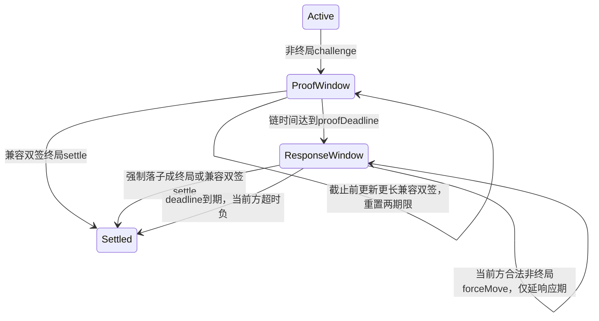

# 区块链真实性、可信核验修复与独立接入实测

日期：2026-11-04。范围：本次工作树的合约、浏览器控制器、RPC/部署身份、证据、统计及自动化验收。本文是项目内部工程核验，不能当作第三方安全审计。原始结果与源文件 SHA-256 见[汇总清单](../artifacts/test-results/trust-audit-2026-11-04/audit-summary.json)。

原版有真实 Solidity/EVM、EIP-712 签名和链上记账，并非只播放界面动画；但默认是本机控制的 Ganache，且存在会影响争议安全和证据完整性的实际缺口。本轮已修复已确认问题，并实现独立 HTTP(S) RPC 与用户浏览器钱包接入。没有部署公网，没有真实资产费用，没有真人钱包插件或真实用户验收。

## 1. 哪些真实，哪些属于测试装置

| 能力 | 实际执行与证据 | 能证明的范围 |
| --- | --- | --- |
| 合约 | solc 编译、部署到 Ganache EVM，真实执行交易，产生 hash/receipt/gas/事件；完整重放规则、验双签、改变积分和托管 | 合约在本地 EVM 中可执行；不是公网部署证明 |
| 双签 | ethers EIP-712 与 OpenZeppelin EIP712/ECDSA，域绑定 chainId、合约、通道和完整有序棋谱 | 持有密钥者授权该棋谱；地址不等于现实身份 |
| 积分 | register 发行1000、双方锁分、胜方取奖池，测试核对守恒 | 无资产价值的合约记账；不是 ERC20、真实抵押或防女巫信誉 |
| 本地测试币 | faucet 使用开发节点 evm_setAccountBalance 设置余额 | 测试装置注资，不是链上付款或真实资产来源 |
| AI/自动演示 | 同一程序控制测试钱包并签名 | 合约执行真实，但不能计作两位独立主体 |
| 外部接入 | 服务端 JsonRpcProvider 连接独立 HTTP RPC；浏览器 EIP-1193 钱包签名/交易；独立节点读取验证 | 功能已实现并用独立本机 HTTP 节点实测，不声称公网或插件真人验收 |
| RPC 核验 | 固定区块、代码指纹、合约摘要、真实链谱及完整成功事件清单 | 相对于配置锚及所连 RPC 的核验；单 RPC 真实性仍为依赖 |

## 2. 已发现并修复的问题

| 编号 | 原问题与影响 | 本轮修复 | 对应验证 |
| --- | --- | --- | --- |
| T1 | 双方已有9手终局双签，输方提交旧1手 challenge 后立即 forceMove 分叉，最新终局被前缀检查挡住 | 增加 proofDeadline；完整举证期结束才允许强制续走，其后保留完整响应期 | [修复前真实失败](../artifacts/test-results/trust-audit-2026-11-04/before-fix/dispute-security-results.json)、[合约14组](../artifacts/test-results/trust-audit-2026-11-04/contract-results.json)、[独立安全3组](../artifacts/test-results/trust-audit-2026-11-04/dispute-security-results.json) |
| T2 | 额外 domain.salt、compact64/raw-v 等表示可被 ethers 接受却与当前合约签名入口不一致 | 严格4字段域、65字节且 v=27/28；无签空谱明确 signed:false | [真实链证据9项](../artifacts/test-results/trust-audit-2026-11-04/evidence-chain-results.json) |
| T3 | 文件省略交易清单或伪造 gas 会扭曲交易数/节省；RPC 未核对真实棋谱与摘要 | 统一共享核验，分页扫描6类通道事件，gas/timestamp/receipt 从节点重建；检查域、代码和实际链谱 | 同上，及[实际 CLI RPC](../artifacts/test-results/trust-audit-2026-11-04/cli-live-rpc.json) |
| T4 | 短谱/空谱导入可能覆盖本地最新双签；自动房间恢复清空内存后仍有同类遗漏 | 导入与中继安装都检查持久化最新前缀、参与者及 stake；失败不覆写，保留独立恢复入口 | [恢复/计量47项](../artifacts/test-results/trust-audit-2026-11-04/channel-client-ai-reconnect-refresh-results.json) |
| T5 | 导出把 UI 棋盘当链上状态；外部 RPC 结算或中继漏报交易时，正常页面仍可能显示0gas/100%节省 | checkpoint 与实际 getChannel/区块分开；链状态变化时补齐事件，完整核验后才写历史，缓存相同状态；未完整时只显示已观测子集 | 同上、[真实链客户端7项](../artifacts/test-results/trust-audit-2026-11-04/channel-client-network-results.json) |
| T6 | 外部钱包在网络检查与装监听之间切链/切账户，可在错误网络就绪；异步 points 返回也可能复活旧会话 | 授权前装监听、连接代次、固定预期 network、最终链/账户核对、状态提交前检查会话、失败清签名器 | [连接竞态8项](../artifacts/test-results/trust-audit-2026-11-04/connect-race-after-fix/channel-client-connect-race-results.json) |
| T7 | 本地旧 manifest/变更源码可复用错误部署；旧8字段合约在外部配置真实代码 hash 后仍误过启动检查 | schema2 绑定 artifact/runtime hash、构造参数、创世/部署区块及链指纹；读取完整空9字段布局，拒绝误解码 proofDeadline=256 的旧 ABI | [HTTP/部署13项](../artifacts/test-results/trust-audit-2026-11-04/chain-runtime-results.json) |

T1 的合约回归包含实际发送的恶意 forceMove 回滚：交易 `0x53635f39b9dc0b9e5c95520fabf49e8771a3d719c8fdef079535e7e47688ff71`、block81、status0；随后已有九手双签成功 settle：`0x824b55453b3009571963ff37714ad006293d41b81fba9a75b1e9c1e001ed11f7`、block82、status1。它们属于测试用本地链，不能去公网浏览器查询。

## 3. 当前争议时序及观察义务



ProofWindow/ResponseWindow 是解释用子阶段，链上 State 枚举仍只有 Dispute=3。首次非终局 challenge：proofDeadline=now+Δ，deadline=now+2Δ。默认 Δ=60秒，因此旧版“挑战后立即强制落子”的演示步骤已过期。到 proofDeadline 恰等时，challenge 更新被拒、forceMove 开放；到 deadline 恰等时只可超时结算，不可再 forceMove。后续强制续走不重开举证期。

兼容双签终局仍可在通道终结前 settle；诚实方必须在证据期内在线观察并及时上链，签名快照必须独立保存。没有 watchtower 或永久离线保证，节点/中继全部停机时也不能保证在线结算。具体接口见[修订协议](protocol-spec.md)，取舍见[ADR-004至006](architecture.md)。

## 4. 独立接入的实际实现

- [链初始化模块](../server/chain-runtime.mjs)：external 必需 RPC_URL、CONTRACT_ADDRESS、EXPECTED_CHAIN_ID、DEPLOYMENT_BLOCK、EXPECTED_RUNTIME_CODE_HASH；启动探测周期、域、摘要及九字段布局。runtime hash 来自运营者独立核实，不能把“当前节点自己返回的代码”循环当作独立认证。
- [浏览器控制器](../web/src/channel-client.js)：连接按钮只授权账户/读取，注册是独立确认交易；签名与交易交给注入钱包。错误链或代码拒绝，账户/链变化停用旧会话。外部模式不生成测试私钥、不 faucet、不启用 AI/双钱包自动演示。
- [服务接口](../server/index.mjs)：RPC 白名单允许读取、估算和客户端已签 raw 交易广播；不暴露账户解锁、服务端签名、evm/admin/debug。external faucet 返回403。
- [部署准备](../scripts/deploy-external.mjs)：带 --prepare-authorized 才生成未签名部署 JSON 与 gas 估算；不读私钥、不签、不广播。由持有人使用自己的可信钱包实际部署。

[外部链指南](external-chain.md)提供可执行配置和手动部署步骤。支持直接部署的合约，不提供代理升级治理。RPC 需支持部署前后历史 code 和事件查询；大量历史区块应配置可信部署块，扫描每页最多2000块。

## 5. 最终实测结果

以下每项均已实际运行，统计测试组，不是用户数或游戏数。最终 JSON 各自保留，旧37项恢复结果不与新的47项重复相加。

| 层次 | 最终通过/失败 | 入口/原始结果 |
| --- | --- | --- |
| 合约 | 14 / 0 | [测试](../tests/contract.test.mjs)、[结果](../artifacts/test-results/trust-audit-2026-11-04/contract-results.json) |
| 独立争议攻击 | 3 / 0 | [测试](../tests/dispute-security.test.mjs)、[结果](../artifacts/test-results/trust-audit-2026-11-04/dispute-security-results.json) |
| 协议规则 | 4 / 0 | [结果](../artifacts/test-results/trust-audit-2026-11-04/protocol-results.json) |
| AI | 30 / 0 | [结果](../artifacts/test-results/trust-audit-2026-11-04/ai-results.json) |
| 证书 | 9 / 0 | [结果](../artifacts/test-results/trust-audit-2026-11-04/certificate-results.json) |
| 客户端恢复/完整计量 | 47 / 0 | [测试](../tests/channel-client-ai.test.mjs)、[结果](../artifacts/test-results/trust-audit-2026-11-04/channel-client-ai-reconnect-refresh-results.json) |
| 外部钱包真实链 | 7 / 0 | [测试](../tests/channel-client-network.test.mjs)、[结果](../artifacts/test-results/trust-audit-2026-11-04/channel-client-network-results.json) |
| 连接竞态 | 8 / 0 | [测试](../tests/channel-client-connect-race.test.mjs)、[结果](../artifacts/test-results/trust-audit-2026-11-04/connect-race-after-fix/channel-client-connect-race-results.json) |
| 证据真实链 | 9 / 0 | [测试](../tests/evidence-chain.test.mjs)、[结果](../artifacts/test-results/trust-audit-2026-11-04/evidence-chain-results.json) |
| HTTP/部署一致性 | 13 / 0 | [测试](../tests/chain-runtime.test.mjs)、[结果](../artifacts/test-results/trust-audit-2026-11-04/chain-runtime-results.json) |
| 本地 Edge 双上下文 | 8 / 0 | [脚本](../scripts/e2e.mjs)、[结果](../artifacts/test-results/trust-audit-2026-11-04/e2e-results.json) |
| 独立 RPC + 外部钱包 Edge | 6 / 0 | [脚本](../scripts/e2e-external.mjs)、[结果](../artifacts/test-results/trust-audit-2026-11-04/e2e-external-results.json) |

自动测试144项通过；浏览器场景另14组通过。各批分别执行，并非声称运行过一次全新的单命令144项总验收。当前验证入口已自动发现全部测试，默认新建时间戳证据目录。

外部浏览器最终 fixture：独立 ganache.server HTTP，chainId43124；合约 `0xc3413055a7Dba3B434122FbB9C827231975BcFdD`，runtime hash `0x0d1bb16b7af8602d71737defafbcae4dfb458a09478a72aba3a87f87ddc5fa52`。浏览器使用最终 bundle index-ByWgyobB.js。两次注册与本局 open/join/settle 共5笔，其中本局3笔；九手18份 typed 签名、两份 personal 中继认证，结算1010/990、totalLocked=0、totalIssued=2000，RPC/代码/状态/事件/receipt核验通过。errors 与 blockedNetworkRequests 为空；持久化未匹配钱包秘密。以上不是线上可用端点或公共合约地址。

查看[外部连接截图](../artifacts/test-results/trust-audit-2026-11-04/external-screenshots/01-external-connect.png)、[结算截图](../artifacts/test-results/trust-audit-2026-11-04/external-screenshots/03-external-settled.png)和[拒签恢复截图](../artifacts/test-results/trust-audit-2026-11-04/screenshots/07-refusal-recovery.png)。已实际读图，不只依据测试退出码。

## 6. 复现命令与数据保存

在应用根目录运行，Node/依赖使用现有工作区安装；缓存与浏览器配置都留在工作区，不需要全局安装或真实私钥。

```powershell
Set-Location E:\Gomoku\app
$env:TEMP='E:\Gomoku\app\.tmp\trust-recheck'
$env:TMP=$env:TEMP
$env:TEST_RESULTS_DIR='artifacts/test-results/trust-recheck-new'
New-Item -ItemType Directory -Force $env:TEMP | Out-Null
node scripts/verify.mjs
# 自包含独立HTTP节点、钱包接口装置及Edge验收，结束后自动关闭
node scripts/e2e-external.mjs
```

该[外部浏览器脚本](../scripts/e2e-external.mjs)支持 TEST_RESULTS_DIR；不传时默认本次专项目录，因此复验应使用全新结果目录。本轮初次成功和随后同步失败已经另行保留。

本地双人浏览器验收需另起本地服务（一个终端），新目录不得与旧链/并行实例共用：

```powershell
$env:CHAIN_MODE='local'; $env:PORT='4191'
$env:RUNTIME_DIR='E:\Gomoku\app\.tmp\runtime-trust-recheck-new'
$env:CHALLENGE_PERIOD='6'; $env:INVITE_PERIOD='300'; $env:LOCAL_BLOCK_TIME='1'
node server/index.mjs
# 另一个终端设置TEST_RESULTS_DIR/TEMP/TMP后
$env:TEST_URL='http://127.0.0.1:4191'
$env:TEST_SCREENSHOTS_DIR='artifacts/test-results/trust-recheck-new/screenshots'
node scripts/e2e.mjs
```

CLI 离线仅验授权，带 --rpc 后验节点；--contract/--code-hash/--from-block 应由可信部署信息提供，例子见[接入指南](external-chain.md)。本轮实时命令结果[已保存](../artifacts/test-results/trust-audit-2026-11-04/cli-live-rpc.json)，signed=true、cryptographicOnly=false、transactionListComplete=true、codeIdentityVerified=true，本局实际3笔。

失败过程没有删除：修复前攻击失败、runtime首轮7/9、export标志未落盘时43/45、旧连接方法内存回放3/8，以及外部 E2E 在只等交易数而未等终局持久化时4/5。后者调整为等待完整终局证据后，原严格断言全过；没有放宽金额、签名、交易或棋谱断言。名为 connect-race-before-fix 的首跑实际已含父层先落盘的修复，不能当旧版红灯；旧连接红灯以明确标注内存方法回放的结果为准。

Ganache 的 µWS 原生模块与当前 Node 不匹配，自动回退 NodeJS 实现，测试成功不受影响；本地耗时不外推为公网性能。外部 fixture 的 MaxListeners 提示也保留在日志，没有当成通过之外的性能结论。

## 7. 答辩材料与交付状态

按用户后续要求，已重写并生成[可信协作与工程证据V3](../reports/弈信-8分钟课程答辩-V3.pptx)、[打印讲稿DOCX](../reports/弈信-赵国豪答辩讲稿-打印版.docx)及[PDF](../reports/弈信-赵国豪答辩讲稿-打印版.pdf)。重点更新为两阶段争议、节点事实重建、独立RPC/用户钱包和真实攻击修复闭环，采用本轮144项＋14组及当前Gas。V2不动；原81项/18组及立即force步骤只留历史。当前新合约同棋谱9手：3笔/436155 gas 对11笔/1231600 gas；10手：3笔/448093 对12笔/1406433，不混用不同实例。

本轮交付包含安全修复、原始成功/失败记录、更新的V3与讲稿，按用户指示纳入仓库版本；发布状态以main实际提交历史为准。5510395为前一版资料提交。测试临时服务和钱包装置已关闭，旧 Docker/旧链未重建或迁移。

若验收标准是“公开区块浏览器可查、本人真实浏览器钱包插件已连接”，还需要选择实际网络、独立 RPC、部署新合约并经钱包批准网络费用，再做对应真人联调；本轮没有冒称已经完成这些步骤。有效接入代码、启动校验、配置说明与本地真实交易证据已经交付。
