# 任务书

一 总体要求

综合运用软件工程思想开发区块链（通道）五子棋，完成问题定义、NABCD、需求分析、原型、概要与详细设计、编码、测试、交付和报告。依据课程教案选题3，游戏结束时须使用区块链正确结算积分，并尽量避免游戏给底层链带来较大事务负担。

二 基本内容

本项目实现中文Web五子棋、真实本地EVM合约、链下EIP-712双签、积分锁定与结算、非合作争议救济、证据核验和同口径负载比较。按用户安排由一名学生一体化实施，AI辅助产出与验证，不虚构多人分工、会议、访谈或用户满意率。

三 成果与评价依据

需求分析20%、设计35%、编码测试30%、创新10%、真实反馈5%为模板和教案一致的项目内部指标；课程总评在不同课件中存在不同口径，最终以任课教师说明为准。报告提供实际程序、版本记录、测试与回执，公开发布和真实用户反馈暂未发生，单独列示。

四 范围规则

严禁修改 Gomoku 工作区以外的任何内容！工作区固定为E:\Gomoku。外部课程材料只读；源码、依赖、缓存、日志、证据和报告均在工作区。个人信息由本人补填，不冒用参考报告作者信息。

# 摘要

针对区块链逐步处理游戏操作会增加事务负载的问题，本项目设计并实现“弈·信”状态通道五子棋。系统采用React中文交互界面、WebSocket消息中继、ethers签名与RPC适配、Ganache本地EVM及Solidity合约。双方在每一手之后对完整有序棋谱进行EIP-712双签，正常对局仅在开通、加入和终局结算时发送链上交易；合约重放棋谱并检查合法性后分配演示积分。对手拒签或离线时，参与者可提交双签快照进入限时争议，通过更高前缀更新、本人链上落子或超时结算继续完成对局。

工程过程采用NABCD、编号需求、44项WBS、可追踪设计与测试、关键决策记录及版本留痕。实测合约11组、共享协议4组、Edge浏览器8组均通过。9手黑胜的对局交易数由逐步上链基线11笔降为3笔，总gasUsed从1,231,480降为436,143；10手白胜由12笔降为3笔，总gasUsed从1,406,433降为448,105。225手合法和棋真实结算使用3,550,645 gas；浏览器验证拒签最后一手仍能经4笔对局交易正确结算。上述数据来自本地单节点真实EVM执行，不等同于公网上的TPS或真实资产费用。

关键词：五子棋；状态通道；EIP-712；智能合约；争议结算；软件工程

# 目录

[TOC]

目录页码按随附PDF的实际分页自动核对。正文保留课程模板的六章结构；修改内容重新分页后须同步更新目录。个人身份、真实发布和反馈留待本人补充。

# 1 问题定义

## 1.1 项目背景及意义

课程题目同时要求“正确链上结算”和“减少链事务”，因此核心不是把棋盘显示在网页，而是设计规则与信任的分工。每步上链可以直接由合约裁决，但一局m手需处理大量事务；中心化记分虽便捷，却无法提供本题要求的合约结算证据。状态通道将频繁更新移到链下，仅在必要时提交可验证状态，适合参与者固定、规则确定、交替行动的五子棋。

本项目将积分限定为教学用途：地址注册获得1000分，双方各锁定stake，胜者获双方锁分、和棋各返锁分。该记账可以验证守恒和一次性支付，但自由地址注册存在女巫攻击，不能被解释为真实竞技信誉或资产价值。

## 1.2 NABCD分析

| 维度 | 项目分析 | 待验证假设与证据方法 |
| --- | --- | --- |
| N：Need | 核心需求是假设：用户希望对弈顺畅，并能解释积分为何可信；每步等待链确认会破坏节奏，单纯中心化积分又难以自行核验。目标首先是课程同学、休闲棋类用户及想理解通道的学习者 | 尚无访谈。让真实试用者完成落子/结算任务，观察是否理解签名、交易和积分来源；避免把课程要求直接写成已证实市场需求 |
| A：Approach | 前端中文棋盘；每步本地规则校验与EIP-712签名；必要中继仅传消息；开通/结束少量链上交易；合约验证与积分；争议期响应/超时；证据包与可视化 | 以规则单元、协议反例、本地EVM集成和双窗口系统测试验证；先验证安全闭环再扩充玩法 |
| B：Benefit | 正常落子无需逐步链确认；对局可追溯；单方拒绝继续仍有退出机制；用可视化帮助理解链下与链上成本 | 分开测点击响应、签名耗时、交易次数及gas；用户是否读懂界面由真实任务反馈判断。收益不写成已达成百分比 |
| C：Competitors | 比较三类替代方案：中心化在线五子棋、每步上链游戏、签名通道游戏。前者体验成熟但依赖服务方记分；逐步上链易核验但交易多；通道复杂且要求保存状态并监控争议 | 本文未实测具体商业产品，以上为架构比较。后续具体竞品须记录官网/仓库URL、访问日、许可证/版本、截图与实测范围；不编造产品缺陷或用户量 |
| D：Delivery | 准备公开介绍/下载/源码页，提供截图、真实获取路径、中文启动说明、演示视频；用户下载后可在自己机器运行本地EVM；课堂8分钟展示并收集真实反馈 | 公开页至少保留1个月是课程要求。静态页和本地完整链演示的差别须标明；上线时间/地址/保留期限等真实发布后填写，当前未声称已发布 |

## 1.3 基本目标与范围

系统须支持不同浏览器上下文的独立钱包对局、合法棋谱双签、链上自然终局结算、不合作争议、邀请到期退款、证据导入导出与真实负载展示。规则为15×15自由五子棋，黑先，无禁手，连续至少五子获胜，满盘无胜为和棋。提前认输、约定和棋、公共匹配、AI棋手及可兑现代币不在v1实现范围。

设计创新集中在可解释可信流程：界面分别展示提案、双签确认与链上结算；合约同时校验签名与规则；拒签最后胜手有可执行救济；观察钱包可独立核验证据；负载比较公开初始化与异常成本。这里的创新是组合实现与课程工程价值，不宣称首创或安全证明。

## 1.4 可行性与方案选择

技术上，五子棋规则确定且最多225手，紧凑bytes棋谱能够在本地EVM完整回放；OpenZeppelin提供成熟typed-data和ECDSA基础，ethers处理钱包、ABI与RPC。资源上，已配置Windows、Node和Edge即可运行，无需公网钱包、真实代币或付费节点。经济上避免真实资产费用，但不把开发和维护人力成本记为零。工程上采用单应用进程和共享规则模块，降低部署复杂度，并以规则、安全、系统和证据测试控制风险。

| 方案 | 适合的目标 | 本项目判断与证据边界 |
| --- | --- | --- |
| 中心化服务记分 | 便捷同步、账户管理 | 架构简单，但积分最终依赖服务方；不满足本项目真实合约结算要求。属于架构推理，未进行商业竞品实测 |
| 每步上链 | 所有落子由合约直接验证 | 本项目自主基线GomokuOnchainBaseline采用相同规则/积分；每局open+join+每步playMove，最后手自动结算时m+2笔；真实gas结果待测试证据 |
| 应用专用双签通道（当前） | 低正常事务量、清晰规则、可解释争议 | 每步双方对完整新谱签名，合作终局3笔；争议转链上推进/超时，代价是保存证据/在线监控，正常少交易不代表异常恒定少交易 |
| 通用状态通道框架go-perun | 泛化双方通道、注入链后端、持久化和watchtower | README列出相关能力，但接入Go及对应后端会扩大本课设范围；作为方案参考，未导入或移植其源码/协议证明 |
| EVM应用框架MUD | 存储、升级、委托与前端同步等通用基础 | README支持这些能力陈述，但不据此称MUD是签名通道或自带低事务五子棋；本项目不引入整套框架 |

## 1.5 人员与进度管理

项目按用户要求由本人统一承担产品、需求、设计、实现、验证和报告责任；AI作为工具辅助，不列作有学号的组员。参考图书馆范文明确存在单人实施示例，但这不能替代本项目向教师确认课程安排。本次实际采用一个会话连续增量实施，各阶段留有真实工具记录和Git提交；不把计划116小时写成已经工作116小时，也不伪造30天提交历史。

图1-1给出相对甘特规划。44项WBS涵盖从材料分析到交付展示，详细任务见附录A；实际已验证与待办矩阵见第5章。

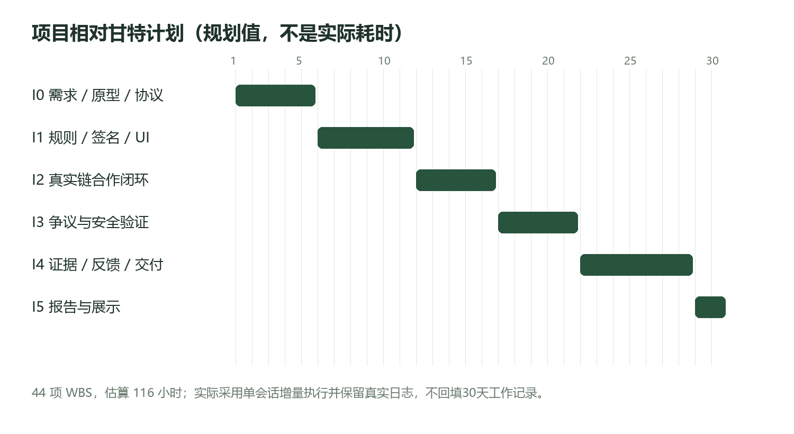

| 迭代 | 相对工作日/预算 | 交付增量 | 退出门槛 |
| --- | --- | --- | --- |
| I0 定义与风险验证 | D1–D5，19h | 课程映射、NABCD、需求、WBS、原型与安全ADR | 来源/范围/签名与争议语义清楚；不使用假反馈 |
| I1 链下完整对弈 | D6–D11，23h | 规则、棋盘、双签、双地址同步、持久化 | 合法局可玩；规则/签名反例过关；原型与产品标注一致 |
| I2 真实合作链闭环 | D12–D16，20h | 本地节点、注册/锁分、开通/加入、合约棋谱验证、结算、交易UI | 真实部署/开局/结束回执；非法状态拒绝；锁分释放守恒 |
| I3 非合作退出 | D17–D21，19h | 争议、forceMove、期限、强结算、断连与重放测试 | 旧状态纠正、拒签胜棋、最后时刻完整响应期、边界有证据 |
| I4 验证与实际交付 | D22–D28，27h | 证据、对照、性能、适配、说明、发布准备与真实反馈 | 数据口径可查；公开发布和反馈未发生则保留缺口，不能过度宣称 |
| I5 报告与展示 | D29–D30，8h | 课程模板报告、个人体会、8分钟展示 | 文档/源码/测试/链证据一致；课程检查清单逐项标状态 |

## 1.6 风险管理

优先处理签名未绑定业务状态、旧快照覆盖、更高状态不给下一方响应时间、最后一手拒签、最长局gas以及本地单链被误称生产可信等风险。具体缓解是完整谱与域绑定、前缀单调、有效推进重置期限、forceMove、真实长局结算、明确监控义务。公开反馈与外部发布为尚待本人完成的日历依赖，无法由自动化执行替代。

# 2 需求分析

## 2.1 需求获取与业务目标

需求主要来自课程选题、教案、PPT和用户直接指示。没有开展真人访谈，因此NABCD中的用户价值和推广判断作为待验证假设。需求分业务、用户、功能和非功能四层，使用SRC→BR→UC→FR/NFR→AT→原始证据建立追踪。需求基线共26项FR、15项NFR和12组验收场景，不把基线文本的存在等同于所有要求均已验证。

| 业务编号 | 目标 | 成功判据/证据 |
| --- | --- | --- |
| BR-01 | 可以顺畅完成真实双人五子棋 | 两个不同参与方完成合法对局；客户端规则、棋谱和合约结果一致 |
| BR-02 | 积分具有可验证的结算来源 | 本地EVM真实回执、合约积分读取、事件可追溯；重复结算无效 |
| BR-03 | 降低正常对局对底层链的事务负担 | 实际正常路径交易与链下落子数分别计数；对照每步上链基线并公开统计口径 |
| BR-04 | 对手不合作时有明确退出路径 | 本地链真实执行挑战、响应、期限前拒绝及到期强制结算 |
| BR-05 | 让非区块链用户理解可信来源与代价 | 中文状态解释、签名/交易区别、证据导出、真实用户试用反馈 |
| BR-06 | 形成可复核课程工程成果 | 可追踪需求、设计、版本、原始测试、≥30项WBS、实际发布和反馈证据 |

## 2.2 UML用例与用户流程

图2-1给出参与者与功能边界。两个玩家分别保管测试私钥；观察者可查看和核验证据，但不能执行成员挑战或落子。中继是通信基础，不是计分裁判。

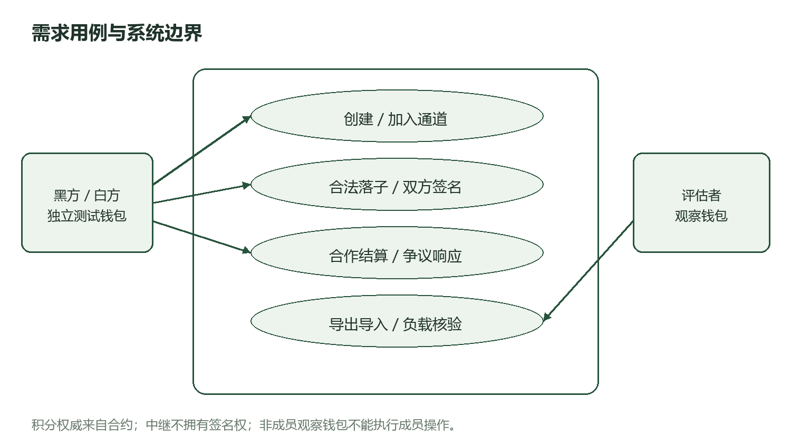

| 用例 | 主角色 | 前置→主成功场景→结果 | 异常/关联需求 |
| --- | --- | --- | --- |
| UC-01 了解和配置 | 玩家/评估者 | 阅读说明→检查本地节点与链/合约→选择本地账户→就绪 | 节点不可达/错链阻止交易；FR-01/02/03 |
| UC-02 创建与加入 | 两玩家 | 不同地址、明确stake/规则→注册有余额→黑open/白join均成功并锁分→Active | 同地址/余额不足/重复ID/未确认不可开始；未加入到期退款；FR-04/05 |
| UC-03 链下对弈 | 两玩家 | 合法当前状态→当前方选空格签新完整谱→对方验证并签同谱→双签保存并更新轮次 | 越界、占位、错序、丢包、拒签均不提交为committed；FR-06至10 |
| UC-04 合作结算 | 两玩家 | 合法终局且完整双签→提交真实settle→按胜负/和棋释放锁分 | 交易失败不能显示已结算；首版无提前认输/合意和棋；FR-11/12/17 |
| UC-05 非合作退出 | 任一玩家 | 有双签快照/空谱→challenge→更高前缀快照或本人forceMove→终局即时/非终局到期结算 | 旧状态、前缀、最后一手拒签、期限边界；FR-13至16 |
| UC-06 查看与恢复 | 玩家 | 保存证据→刷新/重连→读取链状态并校验本地签名→恢复同一棋局 | 无可信本地最新状态须提示风险，不能自动造状态；FR-10/18 |
| UC-07 导出核验 | 玩家/评估者 | 对局或结算证据→导出→重新导入校验→显示每项结果与限制 | 篡改、缺失RPC、链重置分别说明；FR-19/20 |
| UC-08 比较负载 | 评估者 | 选择同局→查看真实交易和假设基线→读取统计定义与原始回执 | 无数据时空状态，不填示意数冒充实测；FR-21/22 |
| UC-09 获取与反馈 | 真实用户 | 真实获取软件→完成任务→自愿反馈→形成问题与迭代 | 未发布/无人试用如实记缺口；FR-23/24 |

## 2.3 功能需求与验收标准

| 编号/优先级 | 功能与来源/目标 | 验收标准 |
| --- | --- | --- |
| FR-01 P0 | 中文首页、规则与流程指引；SRC-03/BR-05 | AC-F01：首次访问可找到开始对局、规则、积分说明、链状态和证据入口；状态/错误用中文解释，提供本地演示身份说明 |
| FR-02 P0 | 真实链连接与健康检查；SRC-01/BR-02 | AC-F02：RPC可达且chainId、部署合约匹配才允许链上操作；节点关闭/错误链/无代码地址时阻止发送并显示原因；健康状态来自真实读取 |
| FR-03 P0 | 本地账户与签名授权；SRC-03/BR-02 | AC-F03：展示当前地址和仅限本地测试提示；两玩家地址不同；拒签、切换账户或切换链后原操作停止且不伪造成功 |
| FR-04 P0 | 注册、邀请与参数确认；SRC-03/BR-01 | AC-F04：每地址最多注册领取一次1000分；开局前查看黑白地址、stake、规则、邀请/争议期；不足额/相同地址/重复ID拒绝；未加入邀请到期仅黑方可取消并退锁分 |
| FR-05 P0 | 合约开通并加入对局；SRC-01/BR-02 | AC-F05：黑open和白join产生真实交易并分别锁stake，白方加入后才Active；读取唯一channelId及不可变参数；pending/revert不可标为开局成功；已注册玩家正常open+join+settle=3笔 |
| FR-06 P0 | 棋盘落子与规则；SRC-03/BR-01 | AC-F06：15×15、黑先、轮流、任一方向≥5获胜；越界/占位/越权/终局后落子均拒绝且seq不变；满盘无胜为和棋 |
| FR-07 P0 | 每步EIP-712完整棋谱双签；SRC-03/BR-02 | AC-F07：每个committed新谱具有黑白双方State(channelId,movesHash)签名；篡改棋谱、错签人/链/合约/局均失败；v1跨完全相同链重建的限制须说明 |
| FR-08 P0 | 对端验证与同步；SRC-03/BR-01 | AC-F08：接收方独立验签并确认恰扩展一手、轮次/占位/前缀后签同谱；非前缀/跳步拒绝；重复消息不重复落子；单签pending与双签committed清楚区分 |
| FR-09 P0 | 完整状态有效性；SRC-01/BR-02 | AC-F09：客户端与合约针对同一棋谱给出一致结果；即使签名正确，非法顺序、轮次、占位、伪造winner、终局后追加也在链上拒绝 |
| FR-10 P0 | 本地持久化与提交状态；SRC-03/BR-04 | AC-F10：已验证棋谱和签名刷新后可读取；待签/待发送/已验/已上链区分；存储失败有提示；不把尚未收到的对方签名补造为完整证据 |
| FR-11 P0 | 合作终局结算；SRC-01/BR-02 | AC-F11：合法五连/满盘且双方快照签名可settle；非终局合作settle拒绝；Dispute中不回退或使用不相容谱；UI以回执和读取为准 |
| FR-12 P0 | 链上锁分、释放与幂等；SRC-01/BR-02 | AC-F12：open扣黑stake、join扣白stake，胜者获2stake、和棋各返stake；取消邀请只返已锁黑stake；注册外总可用+锁定积分守恒，重复结算不改余额 |
| FR-13 P0 | 发起挑战；SRC-03/BR-04 | AC-F13：仅成员可用有效双签快照或初始空谱challenge；非终局生成seq/deadline，终局即时结算；非法证据/越权拒绝 |
| FR-14 P0 | 更新快照或强制落子；SRC-03/BR-04 | AC-F14：t<deadline时更长且原谱为前缀的双签快照可更新；仅当前方可forceMove合法一手；低/同序/非前缀拒绝；有效非终局推进重置完整响应期，终局即时结算 |
| FR-15 P0 | 超时强制结算；SRC-03/BR-04 | AC-F15：t<deadline拒绝claimTimeout，t>=deadline仅成员可调用且当前应落子方超时负；无需对手签名，胜者获2stake一次；已终局由对应交易即时结算 |
| FR-16 P0 | 争议提示与链时间；SRC-03/BR-05 | AC-F16：展示候选seq、轮次、剩余期、可执行动作与监控义务；浏览器改时间不改变合约授权；节点不可达时不显示确定可结算 |
| FR-17 P0 | 交易生命周期与错误恢复；SRC-03/BR-02 | AC-F17：待授权/已发送/待确认/成功/失败区分，提供真实txHash；重复点击不形成重复积分；拒签/revert/RPC断连允许安全重试或重新读取 |
| FR-18 P0 | 重连与链重置识别；SRC-03/BR-04 | AC-F18：刷新后核对链上状态、部署实例与本地证据；重置链或部署变化时隔离旧状态，不把旧交易标当前有效；中继离线仍可使用证据发起链上退出 |
| FR-19 P0 | 结构化证据导出；SRC-03/BR-05 | AC-F19：可导出含schema、EIP-712域、规则、完整棋谱与黑白快照签名、真实交易/回执、结果和统计口径的数据；不含私钥/助记词；初始化/每局交易缺失明确标出 |
| FR-20 P0 | 证据导入验证；SRC-03/BR-05 | AC-F20：重新导入可重算双方快照签名、movesHash、棋局规则和结果；有RPC时核对回执/事件/合约；无RPC只显示链下校验并标链上未核验；篡改包出现具体失败项 |
| FR-21 P0 | 交易负载对照可视化；SRC-01/BR-03 | AC-F21：同局显示链下步数、正常/争议实际交易数与每步上链基线；实际计数可追到回执；估算明确标注，空数据不显示“节省已达成” |
| FR-22 P0 | 数据口径与gas明细；SRC-01/BR-03 | AC-F22：展示部署/准备/开通/结束/争议分类、成功与失败交易、gasUsed及单位；比较基线有同口径或明确假设；不得将交易数降幅写成TPS/gas降幅 |
| FR-23 P0 | 软件介绍与准确获取方法；SRC-02/BR-06 | AC-F23：介绍页含真实截图、规则、环境、启动/下载/源码入口、本地链边界；正式发布后从独立用户环境核实真实地址与获取方法；保留1个月有安排与记录 |
| FR-24 P0 | 真实反馈与追踪；SRC-02/BR-06 | AC-F24：有真实自愿用户试用记录才填已完成；每条意见关联版本、任务、证据、需求/缺陷及处理；无人试用保留缺口，AI模拟不算 |
| FR-25 P1 | 棋谱逐步回放；SRC-03/BR-05 | AC-F25：上一/下一步和最终棋盘可重建，显示序号与签名者；回放不发送交易、不改积分；非法导入先阻止播放 |
| FR-26 P1 | 多路径演示引导；SRC-02/BR-06 | AC-F26：说明合作胜负、和棋、拒绝合作、旧状态挑战、到期退出的真实操作步骤；测试专用时间推进显式标识且仅允许本地环境 |

## 2.4 非功能需求与验收标准

| 编号/优先级 | 质量属性 | 验收标准 |
| --- | --- | --- |
| NFR-01 P0 | 安全：签名与授权 | 覆盖错签人、棋谱篡改、错域、跨局/跨链/跨合约、旧/非前缀状态；相应边界拒绝且不错误改分；本地链重建前端隔离与密码学域限制分别记录，不声称v1具独立纪元 |
| NFR-02 P0 | 安全：状态与结算不变量 | 合法序列≤225、仅新空格、黑白交替、终局不可追加；gameId仅结算一次；注册发行量=可用余额+未结束锁分，结算释放守恒；合约不得信前端winner |
| NFR-03 P0 | 可复现与环境隔离 | 从锁定版本按说明在E:\Gomoku内安装/构建/启动/测试；缓存、临时、日志、链数据均在工作区；不安装全局、不改系统、不写区外；保留实际命令与原始结果 |
| NFR-04 P0 | 易用与中文表达 | 首页到开局/证据/规则入口可直接找到；中文说明签名与交易区别、超时义务；真实试用目标≥3人（目标非成绩）；报告实际人数/成功任务数/阻塞而非预设满意率 |
| NFR-05 P0 | 交互性能 | 本地环境，预热后100次合法操作采样，点击至视觉反馈P95目标≤100ms；签名等待/网络往返/链确认单独测量，不计入纯渲染指标或虚构排除异常 |
| NFR-06 P0 | 交易负载 | 正常双签落子不发交易，已注册玩家每局open+join+settle=3笔成功交易；部署/注册另计；逐步上链基线若最后落子即结算为m+2笔（同open/join）；未实测基线标估算；争议/失败另计并附回执 |
| NFR-07 P0 | 终局/争议可执行性 | 最长合法有效棋谱的结算与挑战在配置的本地区块gas上限内成功，记录gasUsed与上限；目标≤区块上限80%作余量，若未达需优化或明确限制，不只测9步短局 |
| NFR-08 P0 | 可靠性/恢复 | 浏览器刷新、重复消息、中继断开、RPC中断、交易失败后不产生静默丢子/重复积分；链恢复后以合约状态核对；证据缺失需明确提示无法保证恢复 |
| NFR-09 P0 | 可访问性与适配 | 360×800、768×1024、1440×900视口下核心流程可操作，棋盘不与操作栏重叠；按钮有文本名、焦点可见、键盘可选格并确认；不只靠颜色区分棋子/状态；正文对比度目标≥4.5:1 |
| NFR-10 P0 | 隐私与本地密钥 | 扫查源码/配置/日志/证据不含真实密钥、助记词和非必要个人资料；演示签名器只允许已配置本地测试链；导出包无私钥字段；用户录屏/照片保存须有同意 |
| NFR-11 P0 | 可维护与一致性 | 规则、typed-data、链适配、UI、证据验证分层；接口与schema版本明确；对同一测试向量前端与合约一致；变更记录关联需求、ADR和测试 |
| NFR-12 P0 | 依赖与许可证 | 核心依赖锁定版本；依赖清单含来源/用途/许可证/自主实现边界；无明确许可素材不可公开使用；不能把第三方游戏核心当本人原创 |
| NFR-13 P0 | 数据诚实与可追踪 | 所有“已实现/已测试/已发布/用户认为”都有可定位证据；图表区分实测/估算/设计；测试失败和局限保留；不编造团队、采访、交易或效率提升 |
| NFR-14 P0 | 本地网络安全边界 | 节点/RPC/演示账户默认仅本机使用；错误链/公网RPC配置阻止演示密钥发送；不把公开静态页误写成公开真实链服务；实际绑定地址与CORS策略记录 |
| NFR-15 P1 | 兼容性与展示质量 | 至少在实际可用的两种浏览器环境核验或明确单浏览器局限；统一字体/间距/按钮/棋盘风格，无乱码、假进度、不可点击主按钮；记录真实截图与版本 |

## 2.5 可交互原型与最终界面

原型通过可运行Web界面实现完整闭环，并逐步接入真实链。图2-2为真实浏览器截图而非设计占位图：左侧棋盘、右侧对局控制、独立钱包积分、提案确认与异常实验。普通标签同源共享localStorage钱包，双人必须使用不同浏览器配置或独立上下文。

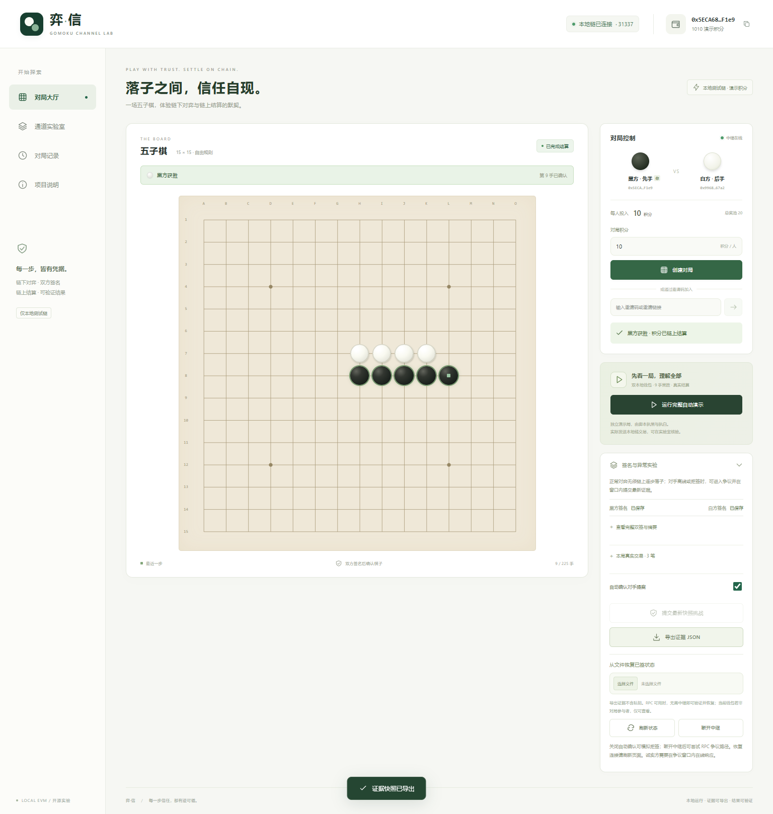

实验室展示当前真实交易和已确认手数，m+2为对照口径；未结算时标为当前快照，不能当最终降幅。图2-3展示完整数据解释。

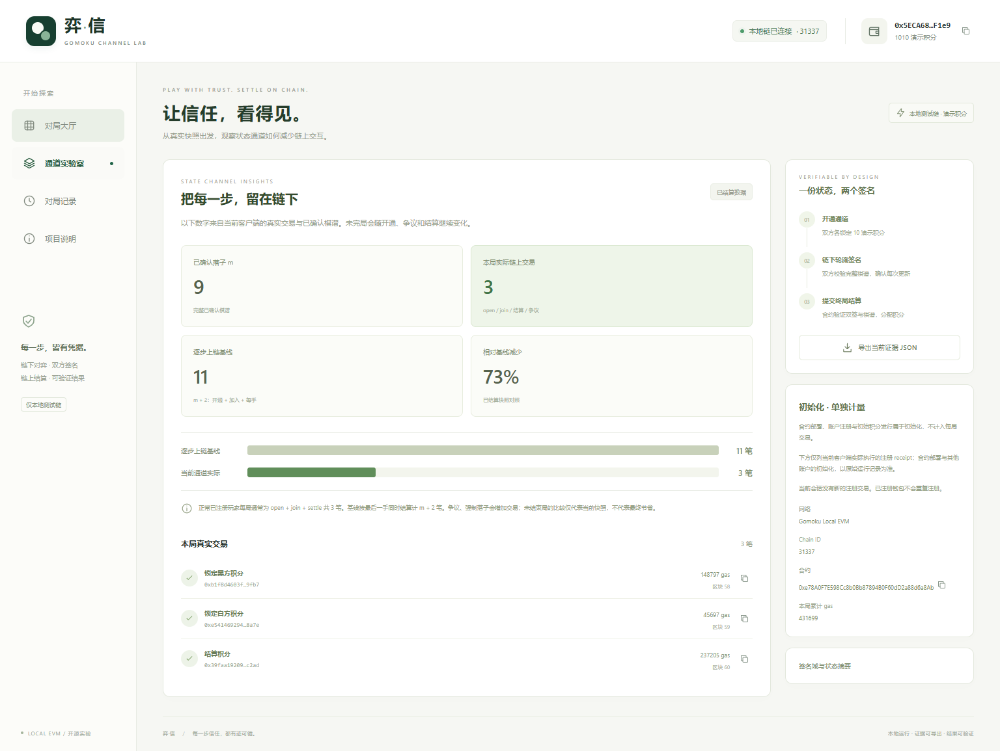

证据导入在另一观察钱包中执行双签、规则、链上参与者和每笔回执核验；篡改后显示错误。手机390像素视口通过无横向溢出检查，但未据此宣称所有设备或全部无障碍合规。

# 3 概要设计和详细设计

## 3.1 架构选择与部署边界

当前采用单机教学部署：React前端经Vite构建为静态资源；Express以同一端口提供页面、REST、WebSocket和JSON-RPC代理；进程内Ganache执行真实EVM交易并持久化链数据；Solidity合约独立维护邀请、锁分、争议与结算。WebSocket中继仅协调链下双签消息，不持有玩家私钥、不决定链上积分。

| 层/文件 | 静态可确认的职责 | 需求关联 |
| --- | --- | --- |
| UI（按[Web接口](app-interface.md)约定） | 订阅snapshot，绘制15×15棋盘/双方/积分/状态/实验室/历史，调用控制器；本文未静态核验最终UI全部细节 | FR-01/06/16/21/23 |
| [ChannelClient](../web/src/channel-client.js) | 浏览器测试钱包、连接/认证中继、签名、双签快照核验、合约交易、状态订阅、导出、脚本演示 | FR-02至20 |
| [共享规则](../shared/gomoku.mjs) | 独立evaluate、前缀/恰一手扩展、bytes编码、typed-data类型、负载统计、连接认证文本 | FR-06至09/21/22 |
| [Express/WS服务](../server/index.mjs) | 本地节点/部署、配置与房间API、连接认证、提案/确认中继、回执核验、房间落盘、页面托管 | FR-02/04/08/17/18 |
| [GomokuChannel](../contracts/GomokuChannel.sol) | 注册教学积分、开通/加入/取消、双签/全谱校验、挑战/forceMove/超时、积分结算 | FR-04/05/09/11至15 |
| [GomokuOnchainBaseline](../contracts/GomokuChannel.sol) | 继承相同积分与规则，提供playMove逐步上链测量基线；代码存在不等于已实测 | FR-21/22，NFR-06/07 |
| [编译脚本](../scripts/compile.mjs) | solc 0.8.30、Shanghai、优化器200次，读取工作区依赖并导出ABI/字节码 | NFR-03/11/12 |

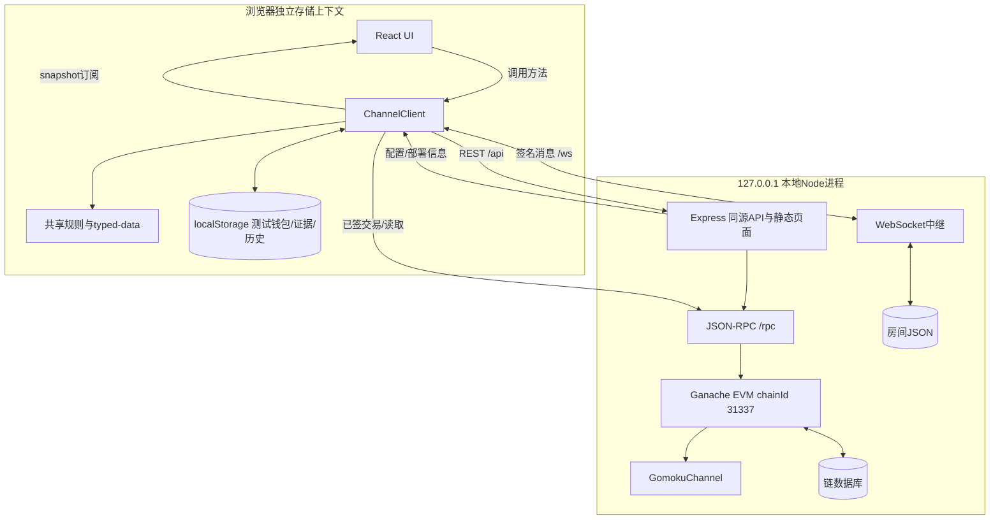

源码默认PORT=4173、只监听127.0.0.1；这些是配置默认值，不证明当前服务已启动或该URL可访问。Ganache默认chainId=31337、Shanghai、区块gas上限30,000,000；部署challengePeriod默认60秒（可由环境变量调整），invitePeriod=300秒。实际运行值以真实配置和链读取为准。

此模型的价值是能复现真实EVM执行、签名验证和收据；不能称其为多个独立验证者组成的生产共识网络。开发RPC含余额/时间等测试能力，本地服务和浏览器测试钱包均属于受控教学环境，禁止映射公网或导入真实资产密钥。

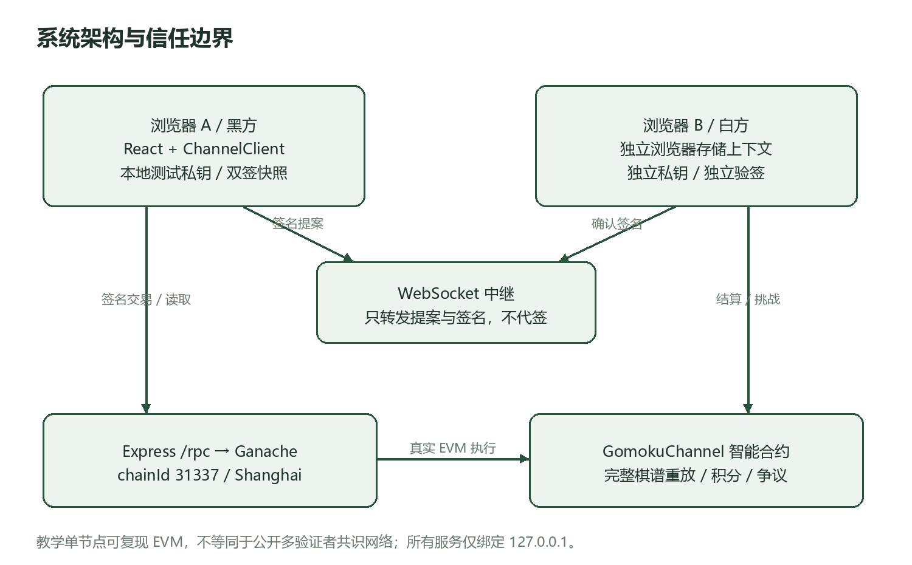

## 3.2 领域对象、数据字典与存储

### 3.2.1 领域类图

下图中ChannelClient、GomokuChannel、GomokuOnchainBaseline、OpenZeppelin EIP712是源码中的类/合约；Room、Checkpoint、Proposal、ReceiptRecord为实际JSON/struct数据模型，图示不表示源码一定声明同名JavaScript class。

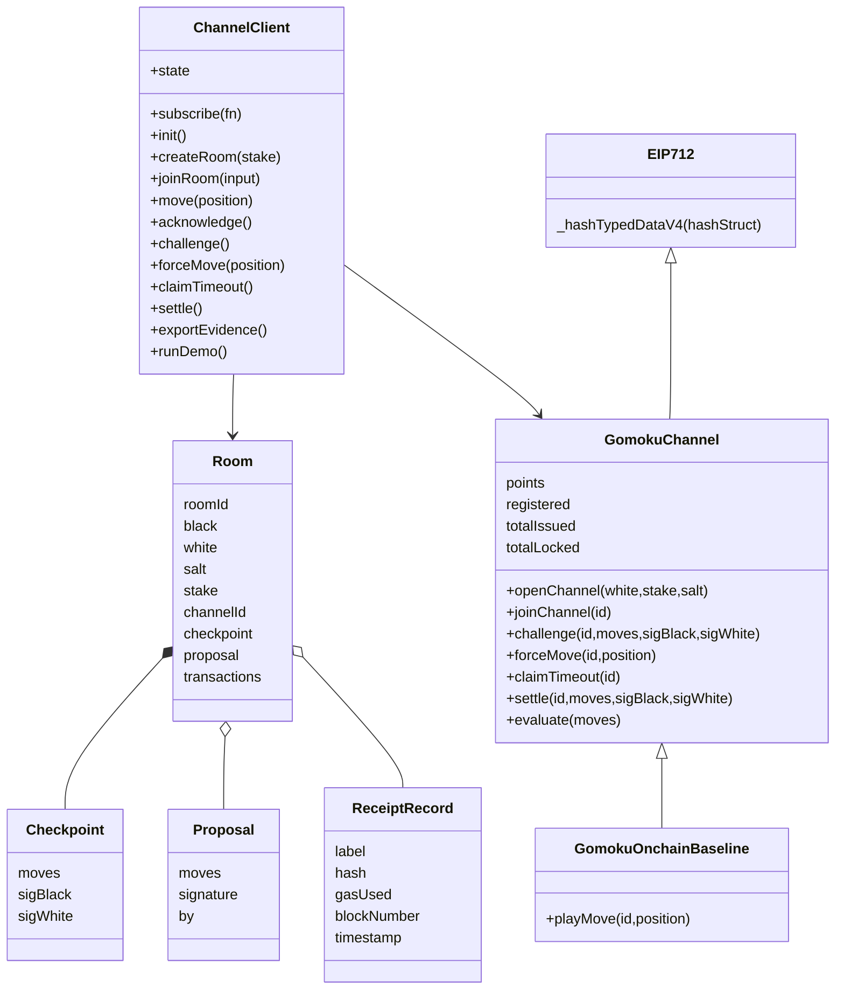

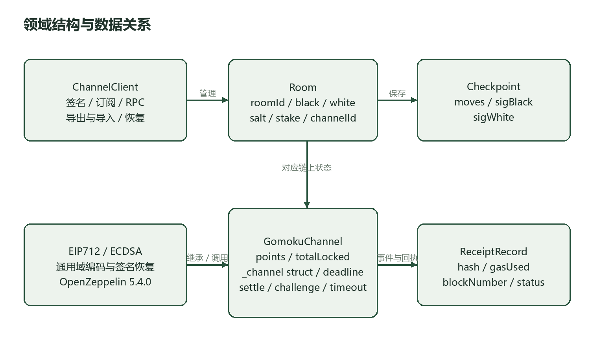

### 3.2.2 关键字段

| 名称 | 类型/值域 | 含义、来源与约束 |
| --- | --- | --- |
| position | uint8/JS整数0..224 | row×15+col；棋色由落子序号奇偶确定，不允许调用者自填棋色 |
| moves | Solidity bytes / JS number[] | 最多225项有序棋谱；每个位置只出现一次；首次终局后不能追加 |
| movesHash | bytes32 | keccak256(movesHex(moves))；完整有序谱的承诺，不仅是最终棋盘 |
| roomId/salt | 随机32字节hex | 服务创建本地房间用randomBytes生成；roomId同时作开通salt，不是人类可读短码 |
| channelId | bytes32 | keccak256(abi.encode(black,white,salt))，同合约内不可重复；白方认证后确定 |
| black/white | address | 开通/加入身份；零白方、自对弈开通被拒绝；地址不是现实身份 |
| stake | uint256；房间API限制1..1000整数 | 每方锁定教学积分；合约本身要求正数且足额，不把API上限误写成合约上限 |
| status | 0..5枚举 | None、Invited、Active、Dispute、Settled、Cancelled |
| deadline | uint256链时间秒 | Invited为加入截止；Dispute为响应截止；Active置0；终局后的字段不表示仍有活跃争议 |
| winner/reason | uint8 | winner 0和/未定、1黑、2白；reason 0未定、1五连、2满盘、3超时 |
| points/registered | address映射 | 每地址一次领取1000教学分；仅合约规则可转移可用/锁定积分 |
| totalIssued/totalLocked | uint256 | 已注册发行总量与所有未结束邀请/对局锁定总量 |
| checkpoint | moves+sigBlack+sigWhite | 双方签同一State的已确认快照；空谱可无签；单签提案不算checkpoint |
| proposal | moves+signature+by | 当前落子方签署新谱，等待另一方确认；中继每局至多一个待确认提案 |
| ReceiptRecord | JSON对象 | 真实receipt的hash/gasUsed/blockNumber及区块timestamp；同hash去重 |
| snapshot | UI对象 | ready/busy/error、身份、状态、棋谱、pending、双方签名、真实交易、metrics、历史等 |

### 3.2.3 数据存储与恢复

| 存储 | 当前源码行为 | 边界 |
| --- | --- | --- |
| 工作区artifacts/runtime/chain | Ganache数据库 | 本地操作者可重置；不能宣称永久外部可信归档 |
| 工作区artifacts/runtime/deployment.json | 地址、chainId、部署hash/gas、createdAt | 启动检查地址是否有code；不等同于全面验证代码hash/编译版本 |
| 工作区artifacts/runtime/rooms.json | 房间、快照、提案、交易；串行saveQueue写入 | 中继落盘方便恢复，不替代玩家自主保管签名 |
| 浏览器localStorage | 同源测试私钥、历史、active-room指针、按channelId存证据 | 私钥明文仅适用于教学；同profile同源标签共享钱包，双人需独立浏览器存储上下文 |
| 内存_checkpoint | 当前双签快照、断开WS后仍保留 | 未刷新时可直接调用链上争议；持久化证据能否在不依赖中继情况下重新加载须额外验证 |
| 用户导出JSON | format、域、参与方、stake、checkpoint、onchain、transactions、initialization、metrics、信任边界 | exportEvidence不导出私钥；importEvidence已新增，先验证双签，再核对实际链和回执 |

init先按合约地址对应的active-room重连中继；失败时读取active-channel指针与已保存evidence，调用importEvidence恢复_checkpoint并进入可直接RPC操作模式。浏览器导入会检查当前合约/chainId、参与方/stake和每笔成功回执所属本局；当前钱包非参与方时role=0可查看，不能越权操作合约。已有代码和最终浏览器回归：正常导出后刷新恢复、独立观察钱包导入双签与3笔回执、篡改包拒绝均通过。中继永久失联后init自动fallback的完整独立场景未在8项用例名中单列，不能由导入成功自动视为全部故障恢复已测；仍依赖原本地RPC在线和原钱包/证据存在，不能称为节点完全失联时可结算。

[离线核验函数](../shared/evidence.mjs)检查schema、域/地址/积分格式、棋谱、双方签名与链下/标称链上棋谱前缀关系，返回cryptographicOnly=true；[命令入口](../scripts/verify-evidence.mjs)加--rpc后额外核对chainId、合约参与方/stake、成功回执目标与通道事件，返回链核验信息。不带RPC的结果不证明链上状态真实；链下证据中的onchain字段是导出快照标签，需RPC查询才能确认，不能只信该JSON声称已结算。

## 3.3 接口设计

### 3.3.1 HTTP与WebSocket

| 接口 | 请求/响应 | 校验与作用 |
| --- | --- | --- |
| GET /api/config | deployment、ABI、challenge/invitePeriod、networkName、pointsInitial | 浏览器构造合约/域的依据；最终积分读取仍来自合约 |
| GET /api/health | ok、chainId、contractAddress | 当前仅返回进程已有配置，不是完整RPC/bytecode/一致性诊断 |
| POST /api/faucet | address→balance、method、localOnly | checksum地址；低余额用evm_setAccountBalance直接设置本地测试币，非真实转账、不能记作“免费链上转账” |
| POST /api/rooms | address、stake→Room | 随机roomId、整数stake范围；仅创建链下房间，不直接开通链 |
| GET /api/rooms/:id | roomId/channelId→Room或404 | 获取邀请/快照；私钥不在Room中，房间号不是隐私访问控制凭据 |
| POST /rpc | 单个/批量JSON-RPC | 代理进程内Ganache；有本地开发方法，不能当生产公开RPC |
| WS /ws：hello/auth | 服务nonce；客户端address/roomId/signature | personal-sign连接认证文本绑定nonce、房间、链与合约；认证不等于State签名 |
| WS：propose | moves、当前方signature | 通道Active、无pending、恰扩展一手、当前方、正确typed-data签名 |
| WS：ack | 对方signature | 不能本人确认自己的提案；验签后形成黑白双签checkpoint并清空proposal |
| WS：sync/room | 同步请求/房间与peers广播 | peers仅是已认证连接地址，不证明真人在线 |
| WS：tx | hash | 服务读取成功回执、目标合约及本局事件后采集；不信客户端自报gas和成功 |

HTTP JSON限128KB；WS maxPayload 32768；认证超时服务端15秒。服务只监听127.0.0.1并对带Origin请求限制localhost/127.0.0.1同端口；无Origin本地程序仍可访问，这些措施不是身份隔离或XSS防御证明。任意同源恶意脚本若执行仍可能读演示私钥，勿将其描述为生产钱包托管方案。

### 3.3.2 合约写接口与权限

| 接口 | 可调用者/条件 | 效果 |
| --- | --- | --- |
| register | 任意未注册地址 | 一次发行1000积分；totalIssued增加 |
| openChannel | 已注册黑方、足额、白方非零非自身、新id | 锁黑stake，进入Invited，建立邀请截止 |
| joinChannel | 指定白方、已注册足额、截止前 | 锁白stake，进入Active |
| cancelUnjoined | 黑方、Invited、到期 | 返黑stake，Cancelled；白方从未锁分 |
| settle | 持有双方合法终局签名的提交者 | Active/Dispute，Dispute须前缀相容，终局则结算；源码不要求msg.sender是成员，因为支付去向由对局固定 |
| challenge | 黑/白成员 | Active或Dispute；后者须截止前、更长且前缀相容；空谱可免签；终局即时结算，否则Dispute并重置期限 |
| forceMove | Dispute中当前轮成员、截止前 | 重放追加一手是否合法；形成终局即时结算，否则重置期限 |
| claimTimeout | 黑/白成员、Dispute且到期 | 当前应行动方负，另一方获双方stake |
| evaluate/stateDigest/getChannel/points等 | 只读 | 棋谱有效性、签名摘要、真实状态与积分 |

settle未检查Dispute期限，当前源码允许有效相容的双签终局在claimTimeout之前提交，即便已过deadline；与claimTimeout同时竞争时以链上先成功执行者为准，后者因not live失败。这是实际接口语义，不能声称过deadline后所有非claim操作都必然拒绝；如需改变，应先更新协议ADR和边界测试。

## 3.4 双签正常路径与状态转换

### 3.4.1 正常对局时序

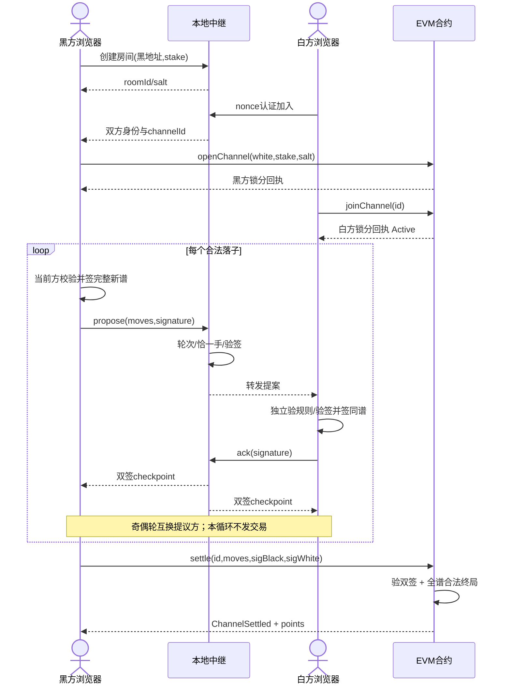

图中循环用黑方提案示意，实际奇偶轮互换提议者。已注册玩家正常每局3笔（open、join、settle）；部署、注册、faucet开发方法分别列账。调用signTypedData产生签名，不产生EVM交易或gas回执。

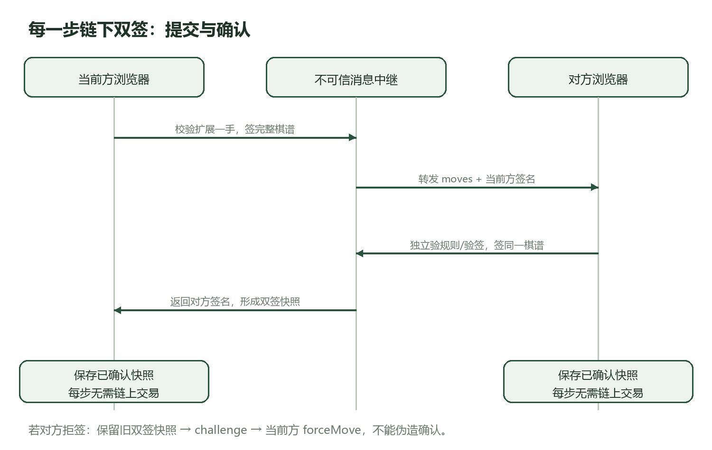

### 3.4.2 生命周期

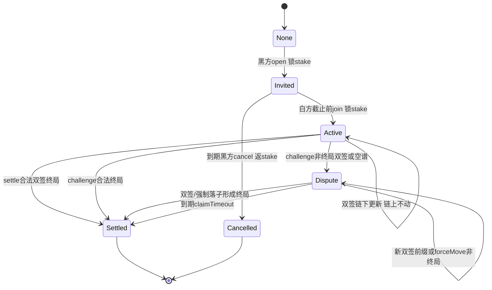

链下pending不是合约状态；未确认的胜棋不能直接当双签终局settle。客户端snapshot可展示“等待确认”，但不得静默推进为committed。

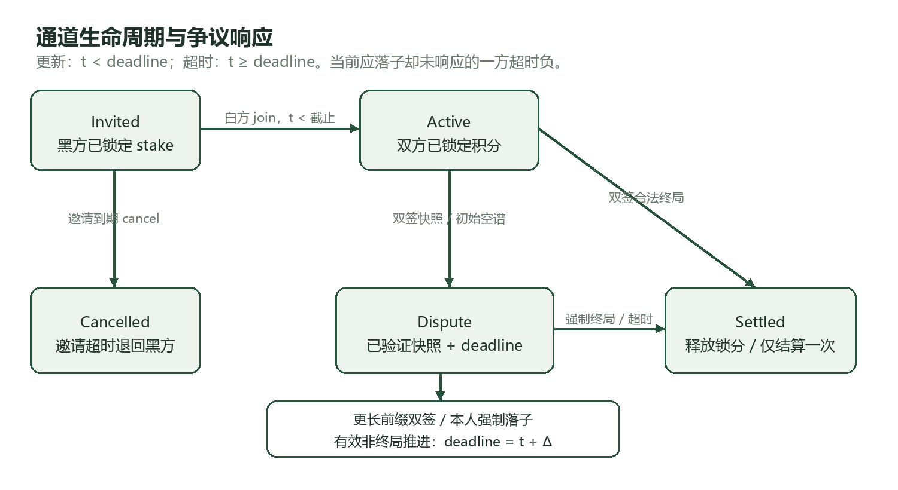

## 3.5 争议、拒签与期限

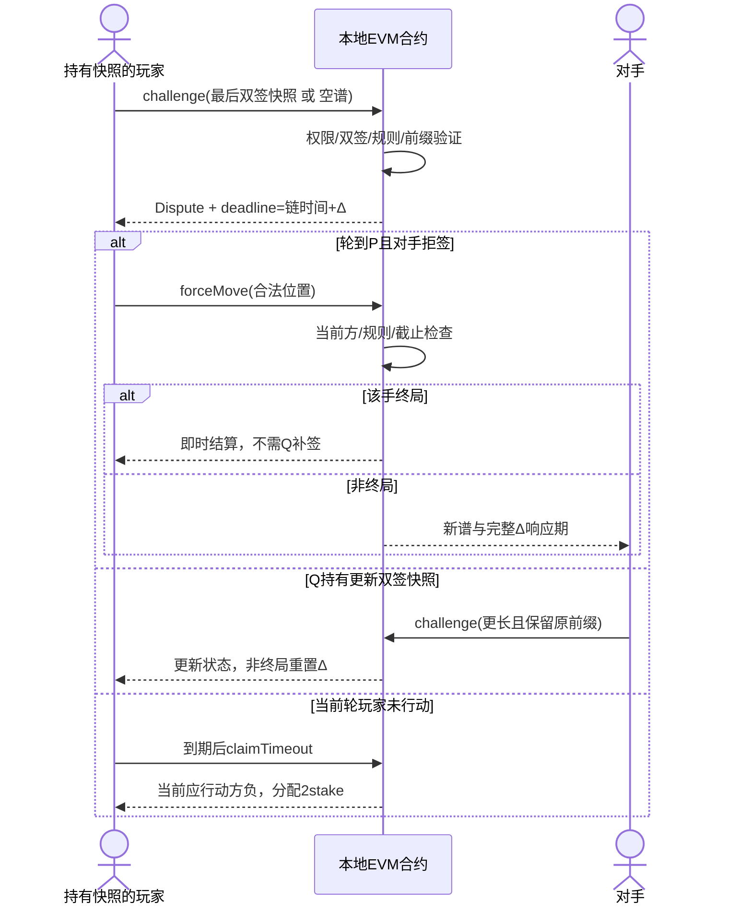

约束：chain timestamp < deadline才能更新challenge或forceMove；>=deadline可claimTimeout。无效/同序/旧/非前缀快照不延长；有效更长状态或强制合法落子才重新给完整Δ。seq上限225，合法推进有界，避免无效消息无限拖延。仍不能保证永久离线玩家公平：玩家须在窗口内监控链并能提交交易，本项目未实现watchtower。

客户端目前state.now采用浏览器墙钟近似倒计时，合约判断采用block.timestamp。两者可能偏离；UI必须以提示方式呈现，交易是否可执行由链决定，不能把浏览器时间当共识时间。若需要精确链上倒计时，应读取最新块timestamp并标记数据新鲜度。

## 3.6 数据流与关键算法

### 3.6.1 顶层/分解数据流

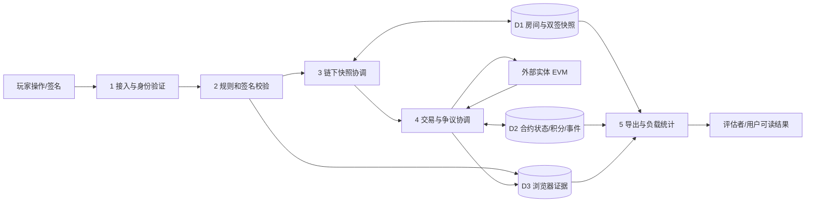

DFD描述数据变换和存储；D2真实存在于合约，不是服务可直接改写的数据库。用户提供的棋谱必须经过规则/签名两条校验，不能从UI输入直接进入积分更新。

### 3.6.2 合法落子与完整棋谱验证

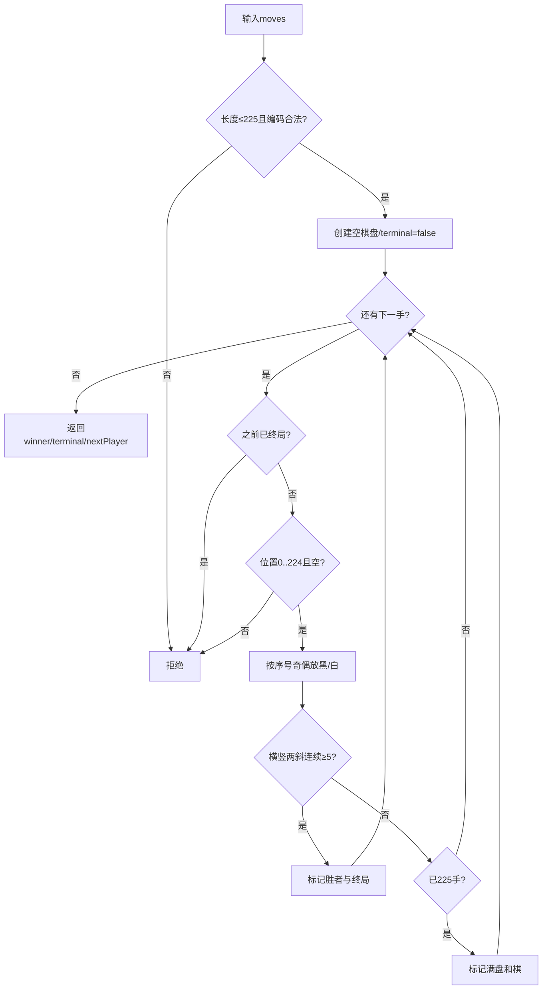

JS规则函数返回board、winner、terminal、winningLine、nextPlayer；Solidity返回winner/terminal。合约每手检查四个方向、每侧最多延伸4格即可判定是否存在≥5连；前端可延伸更长以展示获胜线。225格与方向扫描上界固定，因此完整验证成本随棋谱长度线性增长且有界；实际gas仍必须用真实交易测量，不能由算法阶数推算通过。

### 3.6.3 签名摘要与防重放

源码类型为State(bytes32 channelId,bytes32 movesHash)。结构hash采用keccak256(abi.encode(STATE_TYPEHASH,id,keccak256(moves)))，再由OpenZeppelin _hashTypedDataV4加入域。链下ethers采用同域/同类型signTypedData与verifyTypedData。链/合约/版本隔离、唯一channelId、棋谱前缀与生命周期共同限制重放；单凭EIP-712标准不自动提供业务重放保护。

当前无独立部署纪元/domain salt。人为重建相同chainId、同地址并恢复同一channelId时，域可能相同；新随机salt与实例隔离是运行约束，不能称为密码学跨重建保证。需要更强保证时应升级域或消息，旧签名与兼容策略一起评审。

### 3.6.4 积分守恒与交易负载

注册使totalIssued增加1000；open/join把可用points转入totalLocked；cancel退还已锁黑方；finish把双方2stake全部返还/分给胜者并减totalLocked。对已知已注册地址集合应满足：sum(points)+totalLocked=totalIssued。合约无ETH存取或外部资产支付调用，演示gas用独立的本地测试ETH。

metrics采用baselineTransactions=moves.length+2（m>0），onchainTransactions=transactions.length，savedPercent=(1-actual/baseline)×100，totalGas为所列回执gasUsed之和。该m+2是同open/join并最后一步自动结算的逐步上链模型；m=0时基线与比例置0以防除零。未终局时只能称“当前快照对照”；争议谱里含链上forceMove，当前字段offchainMoves仍简单等于moves.length，不能据此断言所有手都发生链下。

本次阅读时transactions只采集客户端成功回执/中继已验证成功回执；已广播但失败交易并未见独立失败账本。需求FR-22要求失败交易另计，最终报告应补实测原始记录，或明确图表仅含成功交易。基线合约已定义但是否部署/测量、相同棋谱gas数据均以测试证据为准。不能由交易数降幅直接推导gas、延迟或TPS提升。

## 3.7 关键架构决策（ADR）

下列状态为“现有源码已采用的设计，核心合约11组、JS/证据4组、浏览器8组场景已有原始通过记录”，不是教师审批或独立安全审计结论。

### ADR-001：完整棋谱双签，复用OpenZeppelin密码组件

背景：课程要求减少事务又能正确结算。仅由中心服务器判胜难以独立核验；每步上链增加事务；只提交最终棋盘hash无法直接证明落子合法。

决策：当前方每步签完整新棋谱，对手独立验证再签；结算和挑战一次提交最终/最新双签快照，合约完整重放规则。EIP-712结构化域与ECDSA恢复复用OpenZeppelin，浏览器签名/ABI/RPC复用ethers。应用专用协议、前缀检查、规则、积分与界面自主实现。

取舍：最多225字节棋谱传输简单且便于课堂解释，不引入零知识证明/通用通道框架；合约验证成本随m增长，须验证最长合法局gas。双签可能被拒绝，因此必须有challenge+forceMove，不能把“双方必须合作”当安全假设。最新快照证明对完整棋谱的共同授权，并不等于导出包包含每个历史版本独立的全部签名。

验证：前后端同向量digest、错域/错签人/棋谱篡改、非法但双签谱、终局后追加、最长合法谱、重复结算；证据未提供前不标通过。

### ADR-002：注册发行的教学积分与stake锁定

背景：需要实际链上积分结算但不需要真实经济资产，用户明确禁止未经授权产生真实费用。

决策：每地址一次领取1000演示积分，双方各锁stake，胜者获2stake、和棋返还；积分与测试ETH区分。totalIssued/totalLocked支持守恒验证，不实现兑换、转账市场或真实资产存取。

取舍：匿名地址可无限创建，无法防女巫/串谋刷分，积分不能当真实身份信誉；教学流程更易复现。未加入邀请必须能超时退款，避免黑方分数永久锁定。

验证：注册仅一次、余额不足拒绝、邀请取消、胜负/和棋/超时释放、重复调用、sum(points)+totalLocked守恒。

### ADR-003：争议以有效推进重置响应期，并允许本人强制落子

背景：对手可能拒签，尤其最后一手获胜时；仅挑战双签终局无法处理。若新状态在期限末改变轮次却沿用原截止，会导致新轮次方没有响应时间。

决策：challenge接受最新有效双签前缀或初始空谱；Dispute中的新快照必须更长且兼容；当前方可forceMove，合法非终局推进都重置完整响应期，终局即时结算。到期当前应行动方负。

取舍：恶意方可把后续合法对局变成多笔链上操作；推进最多225步但并非恒定3笔。诚实方须监控链且能在期内提交，首版无watchtower。settle与超时的链上执行顺序语义须保留并测试，不凭浏览器倒计时判断不可变结果。

验证：初始空谱挑战、旧状态修正、非前缀拒绝、错误轮次forceMove、胜棋拒签、deadline-1/deadline/deadline+1、有效推进重置期、已结算拒绝。

# 4 实现与测试

## 4.1 实现环境、编码与版本管理

实际运行环境为Windows、Node24.21.0、pnpm11.28.5、Solidity0.8.30、ethers6.17.0和Ganache7.9.2，浏览器为本机Microsoft Edge。合约采用Shanghai指令集、优化器200次；开发链区块gas上限30,000,000。前端分包构建成功，React、EVM依赖和业务包分离，避免首次566KB单包提示。

模块按职责隔离：规则只处理棋谱；控制器封装钱包、RPC与状态；React订阅快照；中继认证身份并校验消息；合约维护权威积分。使用有许可证的通用模块，锁定版本，关键函数语义与前置条件以协议说明和测试反例约束。大段程序放附录，正文侧重调用关系。

版本管理为真实本地Git仓库，尚未推送Gitee/GitHub；未将本地提交写成远程平台截图。下图是实际提交文本的可视化记录，完整历史可用git log复核。

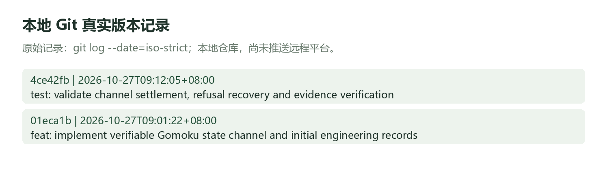

## 4.2 关键函数与调用关系

ChannelClient.move调用共享requireExtension验证恰扩一手，然后Wallet.signTypedData产生提案；接收者验证后acknowledge签同谱；中继提交checkpoint，双方再次验签并保存。ChannelClient.settle发送合约settle，合约先验证EIP-712双方身份再evaluate完整谱，_finish释放锁分。challenge与forceMove通过相同规则回放推动争议；claimTimeout由链上时间与下一方轮次决定胜负。verifyEvidence能离线核验签名和棋谱，importEvidence进一步核对RPC参与者、stake及每笔回执。

## 4.3 计划、环境与复现

验证顺序为确定性规则向量与独立JS oracle→EIP-712签名与真实本地EVM交易→两个浏览器上下文系统验证→真实用户任务。脚本账户和本人双账户均属于测试设施，当前报告没有真实用户访谈、满意率或公开链结果。

| 项目 | 本次合约实测配置 |
| --- | --- |
| 工作区 | E:\Gomoku；源码、依赖、缓存、临时文件和产物均在工作区 |
| Node | v24.21.0；使用用户指定绝对路径 |
| Solidity | 0.8.30+commit.73712a01.Emscripten.clang，本地solc |
| 编译 | evmVersion=shanghai；optimizer enabled=true，runs=200 |
| EVM | Ganache 7.9.2 内存EIP1193 provider，chainId=31337，Shanghai |
| 客户端 | ethers 6.17.0 BrowserProvider；交易由本地测试账户发送，签名在内存完成 |
| 安全库 | OpenZeppelin Contracts 5.4.0 EIP712/ECDSA |
| 时限 | challengePeriod=30秒，invitePeriod=60秒；通过测试RPC明确推进链时间 |
| 上限 | 本地区块gasLimit=30000000；长局发送gasLimit=20000000 |
| 传输 | 合约测试不启动HTTP/RPC外部服务器；无公网部署、无真实资产 |
| 性能说明 | Node24下Ganache uWS原生模块不匹配，自动回退Node.js实现；运行耗时不代表公网性能 |

核心实现和测试入口为 [合约](../contracts/GomokuChannel.sol)、[编译脚本](../scripts/compile.mjs)、[合约测试](../tests/contract.test.mjs)、[测试助手与JS oracle](../tests/helpers.mjs)。直接执行测试文件避免额外测试子进程捕获管道；所有命令工作目录须为E:\Gomoku。

```powershell
$env:TEMP='E:\Gomoku\.tmp'; $env:TMP='E:\Gomoku\.tmp'
& 'C:\Users\lenovo\.dsh\dsh-runtimes\dsh-primary-runtime\dependencies\node\bin\node.exe' scripts/compile.mjs
& 'C:\Users\lenovo\.dsh\dsh-runtimes\dsh-primary-runtime\dependencies\node\bin\node.exe' tests/contract.test.mjs
```

[编译脚本](../scripts/compile.mjs)导出compile(contractName='GomokuChannel')，返回ABI、bytecode、deployedBytecode、编译版本和设置；直接执行时保存 [通道合约产物](../artifacts/contracts/GomokuChannel.json) 与 [逐步上链基线产物](../artifacts/contracts/GomokuOnchainBaseline.json)。导入回调仅从工作区本地node_modules读取，不联网下载Solidity依赖。

## 4.4 编号案例与需求追踪

需求编号与AT编号取自 [需求规格](requirements.md)，协议接口取自 [协议约定](protocol-spec.md)。下表C-01至C-11与原始JSON的tests数组顺序一致。每组包含多项断言，“11组”不能写成只有11个安全条件。

| 案例 | 场景、预期与实际 | 需求/验收映射 | 实测 |
| --- | --- | --- | --- |
| C-01 | 注册仅一次、每地址1000分；构造零时限/非法白方/零额及超余额拒绝；黑方锁分；邀请deadline-1可加入、deadline不可加入且仅黑可取消退款；取消后ID不可复用；守恒成立 | FR-04/05/12，NFR-02，AT-01/05 | 通过，1485ms |
| C-02 | 白方须注册且有足够可用积分；多局锁定不能透支；未加入不能结算；Active不能直接领超时；全局可用积分+托管=发行量 | FR-04/05/12，NFR-02 | 通过，926ms |
| C-03 | 黑白胜、横竖两斜、长连≥5、行边界不缠绕；非法坐标、占位、终局后续走、>225手拒绝；独立JS oracle与合约一致；225步满盘无胜合法 | FR-06/09，NFR-02/11，AT-01/02/11 | 通过，29234ms |
| C-04 | digest与ethers typed-data一致；错chainId/合约/name/version/局、冒名/交换签名、高s/畸形/空签名、改顺序均失败；另一合约同channelId不能重放；正确终局结算且重复无效；已签非法谱仍拒绝 | FR-07/09/11/12，NFR-01/02，AT-02/03 | 通过，4961ms |
| C-05 | 白胜与225步合法满盘和棋真实settle；胜负/原因/棋谱正确；胜者获双方stake，和棋各返stake；重复结算拒绝，实际余额守恒 | FR-11/12，NFR-02/07，AT-01/11 | 通过，21353ms |
| C-06 | 非成员挑战、非空无签名、错误轮次/占位/越界拒绝；无签空谱可挑战；deadline-1强制落子为下一方留完整30秒，旧deadline不能抢先超时；提交8手双签后本人链上补胜棋无需对手末手签名 | FR-13/14，NFR-01/02，AT-06/07 | 通过，4234ms |
| C-07 | 同序/旧/非前缀挑战均拒绝；有效更高前缀重置期限，旧deadline不能抢先超时；settle同样拒绝回退/分叉；短终局不能覆盖更长已上链状态；兼容终局仍可结算 | FR-11/13/14，NFR-01/02，AT-04/06 | 通过，6540ms |
| C-08 | deadline-1不能claimTimeout且当前方可落子；deadline恰等时forceMove/challenge拒绝、仅成员可timeout；分别验证轮到黑/白者超时负，积分仅结算一次 | FR-14/15，NFR-01/02，AT-05 | 通过，1893ms |
| C-09 | 双签终局challenge立即结算；非终局争议到期后、timeout尚未执行时，兼容的双签终局仍可由第三人代提交settle；之后timeout无效 | FR-11/13/15，NFR-01/02 | 通过，5632ms |
| C-10 | 真实发送Active状态下非法timeout，receipt.status=0且记录gas/hash；前后8字段、棋谱、积分和托管额不变 | FR-12/17/22，NFR-02/13，AT-10 | 通过，595ms |
| C-11 | 同样参与方、stake与完整谱，正常通道open+join+settle，基线open+join+逐手playMove，末手自动结算；比较真实receipt gas与笔数，部署/注册另列；基线已上链前缀不能被旧双签覆盖 | FR-05/21/22，NFR-06/13，AT-10 | 通过，11233ms |

余额不变量在邀请、加入、取消、胜负、和棋、争议、超时及失败交易后分别验证：sum(points[address])+totalLocked=totalIssued。统计涵盖本次测试设施全部账户，不把注册发行当作对局收益。

### 协议与证据验证

以下P-01至P-04对应 [协议测试结果](../artifacts/test-results/protocol-results.json) 的4组全部通过记录。它们验证JS规则、计量和证据校验，不把纯JS校验写成额外链上交易。

| 案例 | 实测内容 | 需求映射 | 结果 |
| --- | --- | --- | --- |
| P-01 | JS规则拒绝非法类型、越界、占位、分叉和终局后落子 | FR-06/08/09，NFR-02/11 | 通过 |
| P-02 | 合法长连、四方向及边缘不能跨行连接 | FR-06/09，NFR-02/11 | 通过 |
| P-03 | 0手、正常局、争议额外事务与gas的精确计量 | FR-21/22，NFR-06/13，AT-10 | 通过 |
| P-04 | 独立核验双签证据，篡改棋谱、身份、签名域、积分格式被拒绝 | FR-07/19/20，NFR-01/13，AT-03/09 | 通过 |

### 浏览器系统验证

以下B-01至B-08对应 [浏览器测试结果](../artifacts/test-results/e2e-results.json) 的8组全部通过记录。两个独立浏览器上下文分别持有各自测试钱包，不计为两名真实试用者。

| 案例 | 实测内容 | 需求映射 | 实测 |
| --- | --- | --- | --- |
| B-01 | 两个独立上下文注册各自钱包，分别加载225点棋盘 | FR-01/03/04/06 | 通过，606ms |
| B-02 | 双人邀请并开通真实链上通道 | FR-04/05，AT-01 | 通过，948ms |
| B-03 | 9手双签对局仅有2笔开通交易，错误轮次受限 | FR-06/07/08/21，NFR-06 | 通过，1770ms |
| B-04 | 真实终局结算后共3笔交易，链上积分1010:990，总量2000；导出证据并刷新恢复 | FR-10/11/12/18/19，AT-01/08/10 | 通过，1722ms |
| B-05 | 输家拒签第9手后保存8手双签快照，challenge+forceMove完成结算；该局共4笔交易 | FR-13/14，AT-06/07 | 通过，4350ms |
| B-06 | 明确标记的自动演示独立完成9手、3笔交易结算 | FR-05/11/26，NFR-06 | 通过，4171ms |
| B-07 | 独立观察钱包导入证据，核验双方签名和3笔回执；观察者操作禁用，篡改证据被拒绝 | FR-19/20，NFR-01/13，AT-09 | 通过，1108ms |
| B-08 | 390像素移动视口无横向溢出 | NFR-09（该视口的部分覆盖） | 通过，688ms |

浏览器正常9手局真实gas合计431699，与合约C-11不同实例的436143分别报告，不混用。拒签恢复局保存的checkpoint只有8手，链上最终moves为9手，winner=1，交易为open、join、challenge、forceMove，合计619199gas；未伪造输家对第9手的签名。证据观察导入记录validPackageAccepted=true、observerActionsDisabled=true、tamperedPackageRejected=true。浏览器界面中的基线11笔为m+2口径，不是该浏览器场景另外运行的一局逐步上链实测；真实逐步上链gas对照仍使用下一节C-11。

## 4.5 真实交易与gas对照

以下仅为C-11两局的同环境实测，不含部署和注册。通道双方各锁10分；基线使用同样开通与锁分逻辑、同样完整棋谱和最终自动结算。基线首手交易在同一笔内进入Dispute，之后每步受轮次、棋谱、期限和前缀保护，不额外增加challenge交易。

| 实测局 | 步数 | 通道成功交易 | 基线成功交易 | 通道gasUsed合计 | 基线gasUsed合计 | 交易数降低 | gas降低 |
| --- | ---: | ---: | ---: | ---: | ---: | ---: | ---: |
| 黑胜 | 9 | 3 | 11 | 436143 | 1231480 | 72.73% | 64.58% |
| 白胜 | 10 | 3 | 12 | 448105 | 1406433 | 75.00% | 68.14% |

笔数公式为通道3与基线m+2：双方开通2笔，基线每手1笔且最后一手即结算。gas降低单独由sum(receipt.gasUsed)计算，不从笔数比例推导。所有对照交易hash见 [原始对照数组](../artifacts/test-results/contract-results.json#L1264)，对应逐笔receipt列表含blockNumber、status、gasUsed。部署、注册、争议和发送失败交易均另行分类记录；本次总131笔成功与1笔预期失败包含所有场景初始化，不能作为某一局的成本。

225步和棋已真实结算：gasUsed=3550645，为配置30000000区块上限的约11.84%，低于80%余量目标；receipt.status=1，双方stake各自返还。交易hash为0xd70b542ffe86704719d6b2afa51d0b7e45b8bb38c125b55608de769f7f2fbb64，见 [长局receipt](../artifacts/test-results/contract-results.json#L453)。本次未单独发送225步terminal challenge或224步非终局challenge，NFR-07的长局settle已有实测，长局challenge尚不能标为单独实测通过。

拒签末手恢复的最终forceMove：gasUsed=198919，status=1，见 [强制胜棋receipt](../artifacts/test-results/contract-results.json#L543)。预期失败交易gasUsed=26376、status=0、hash=0x438e0668c2a5856e809a8c1bf6c8efce8b0f6ac5542807f06b4dc6333af038d9，见 [失败receipt](../artifacts/test-results/contract-results.json#L921)。其gas记为失败成本，未混入正常3笔对照。

未运行225笔逐步上链和棋基线；其累计回放25425步，包含满盘回放的规则测试组已耗约29秒，重复长局回放会明显延长本地JS EVM测试。保留225步真实规则和结算验证、以9/10步完整胜局比较交易与gas。不能将公式227笔写成已实测227笔，也不能报告和棋基线gas、TPS或公网费用降低。

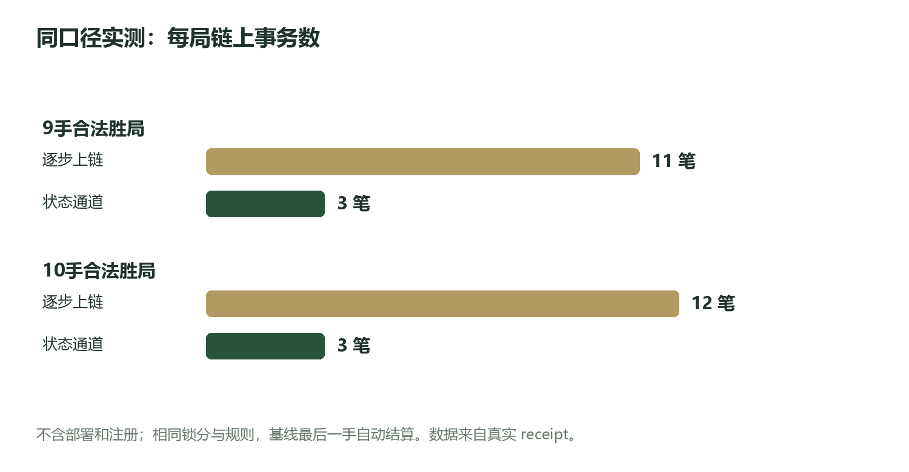

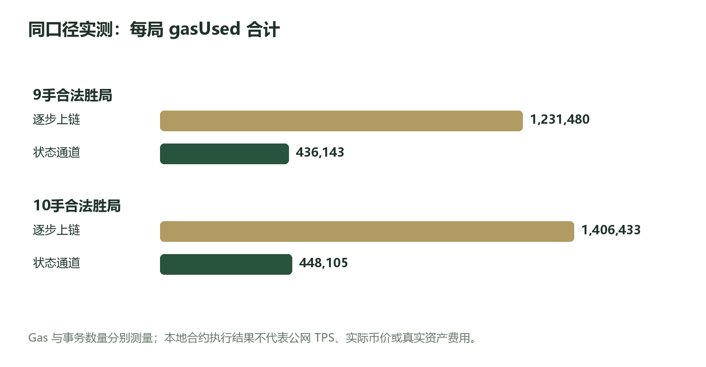

## 4.6 签名、期限与权限安全边界

签名域为name=GomokuChannel、version=1、chainId、verifyingContract；类型为State(bytes32 channelId,bytes32 movesHash)，movesHash=keccak256(完整有序bytes棋谱)。channelId=keccak256(abi.encode(black,white,salt))，单合约生命周期内不可复用。签名既不只绑定某一坐标，也不接受客户端提供的winner；合约回放所有落子自行判定。

| 操作 | 授权与时间 | 被测试的边界 |
| --- | --- | --- |
| join | 仅邀请白方，已注册足额，now<invite deadline | deadline-1允许，deadline拒绝；错人/不够分拒绝 |
| cancelUnjoined | 仅黑方且仍Invited，now>=invite deadline | deadline-1拒绝，deadline成功，重复/ID复用拒绝 |
| challenge | 成员、Active/Dispute；非空必须双签；仅初始空谱可完全免签 | Dispute必须now<deadline且严格更长/原谱为前缀；空谱不能反复延时 |
| forceMove | Dispute、轮到的本人，now<deadline | 错轮/非成员/占位/越界失败；有效非终局deadline=now+30；胜棋即时结算 |
| claimTimeout | Dispute、成员，now>=deadline | deadline-1拒绝、deadline成功；当前应落子方负，重复不再加分 |
| settle | 合法双签终局；可由任意地址代提交；Dispute须与已上链前缀兼容且不更旧 | 拒绝非终局、非法谱、错域、错人、重放、旧/分叉；截止后仍可提交兼容双签终局，先执行的有效结算决定结果 |

deadline采用链时间半开区间，浏览器改时钟不改变授权。测试RPC推进的是本地链时间，不能写成等待了现实30/60秒。覆盖了deadline-1与deadline恰等点；未独立增加deadline+1调用向量，不把需求AT-05所有离散点均写成已执行。终局settle不受challenge期限门限约束，因为双方已授权该兼容终局；与timeout的先后以链上有效交易顺序为准。

## 4.7 失败、修复与复测记录

| 编号 | 真实问题 | 处理与验证 |
| --- | --- | --- |
| D-01 | 首次本地solc导入报Cannot find module memorystream；依赖实际在pnpm布局中 | 主会话修复工作区本地依赖junction/布局；没有自行安装全局依赖；后续编译和完整测试成功 |
| D-02 | 子会话mkdir产物目录遭workspace-write EPERM；子会话不继承父会话动态完全权限 | 未绕过或申请升级；读取Windows沙箱诊断技能后按审批不可用规则停止修复；父会话在其授权环境运行，产物仍限定工作区 |
| D-03 | 失败交易前后getChannel的ethers Result Proxy结构相同，直接assert.deepEqual仍报包装对象不等 | 将两边转Array.from后深比较8字段，不放宽失败交易不改状态的预期；C-10完整复测通过，真实revert gas与status保留 |
| D-04 | 默认计划含225笔逐步上链和棋基线，累计25425步回放存在明显重复执行开销；属于计划调整，不是合约断言失败 | 删除默认比较中的225笔基线；保留225步和棋evaluate、真实settle与守恒，比较保留9/10手完整胜局；明确报告覆盖变化 |
| D-05 | 浏览器早期回归报“链下落子产生额外链上交易”；后续新增路径还遇到争议标签匹配两个元素、校验/验证文案不一致 | 原因为测试沿用旧roomId读取空证据、定位器不唯一及预期文字未与实际文案对齐。取证改为active-channel精确读取当前证据；争议标签定位明确使用first；断言使用实际文案。修复仅涉及测试取证与定位器，不把这些问题归为产品签名/交易安全缺陷，也没有放宽9手仅2笔、结算3笔和拒签恢复4笔的预期。最终8组全部通过，0失败，errors为空 |

原始合约结果由最终完整运行覆盖，早期失败并未伪装为成功；D-03错误和修复另在 [合约工作日志](contract-worklog.md)保留。因进程权限迁移而中止过一个子会话测试副本，停止前四组通过不作为最终11组证据；最终11组以新的完整JSON为准。

## 4.8 局限与待验证

- 本地单节点可被控制者重置，签名证明地址授权而非现实身份。任意新地址可注册1000分，不能防女巫或双方串谋，不代表竞技信誉，也不涉及真实资产。
- v1域没有独立部署纪元。若人为重建完全相同chainId、合约地址、双方和salt，不能宣称密码学上阻止全部旧授权复用；新salt和UI实例隔离只是运行管理措施。
- 诚实方必须在争议期内保存证据、上线观察并提交新快照；当前没有watchtower、永久离线安全或公网可用性保证。对方强制上链会增加交易，正常3笔不涵盖争议成本。
- 本次是确定性案例集，不是形式化证明、随机模糊测试或第三方安全审计；只说明列明环境/输入下断言通过。
- 长局settle已真实执行，长局challenge未独立实测；deadline+1未单独采样。浏览器拒签末手、刷新恢复、观察钱包导入与篡改拒绝已通过列明场景；中继/RPC断连、完全相同实例链重建等更广恢复场景仍须另测。
- 浏览器只实测Microsoft Edge与390像素移动视口，不能推出两种浏览器兼容或360×800、768×1024、1440×900全部通过。响应时间P95、完整可访问性、真实用户≥3人、外部发布与保留1个月没有在此声称完成。

# 5 总结

## 5.1 用户反馈与可用性确认

截至本报告生成时，独立真人试用人数为0，未进行公开发布或连续一个月公开可获取验证。浏览器8组系统测试证明列明路径在测试环境中可执行，不能替代用户反馈。已准备匿名试用任务与记录表，包含首次启动、双人开局、终局结算、理解负载、异常救济和证据核验。需由本人取得真实试用者同意后记录原话、观察、版本和复测，不能由AI生成满意率或照片。

课程要求的真实反馈5%和公开获取页仍存在交付缺口。个人班级、姓名学号、指导教师、课程截止、最终评分口径以及单人安排认可需本人填写/确认。上述事项不妨碍本地程序与工程证据使用，但报告不把它们记为已完成。

## 5.2 已实现成果与创新价值

已完成中文15×15双人五子棋、真实本地EVM合约、每步完整谱双签、邀请与积分锁定、自然终局结算、争议更新/强制落子/超时、证据导入导出核验、负载实验室、真实比较基线、中文启动流程与工程文档。已执行11组合约、4组共享协议和8组浏览器测试，保留真实原始JSON、截图、回执与修复记录。

正常3笔事务并未通过放弃异常安全换取：最后一手拒签时，可用前8手双签进入争议，再本人链上走第9手完成结算，实测4笔事务。合约不信浏览器传来的winner，而是重放合法棋谱。事务数与Gas分别统计；初始化、失败成本和覆盖局限明确列示，便于课程评估与后续复现。

## 5.3 局限与后续方向

本地开发链由单机控制，重置或停机会影响证据可用性，不提供生产共识保障；本地RPC含测试管理能力，仅绑定回环。自由注册存在女巫攻击，积分不可当真实资产或反作弊信誉。诚实方须在争议期限内监控，首版没有watchtower。签名域不含独立部署纪元，完全相同链ID/地址/通道ID的人为重建不能声称强抗重放。生产化还需外部钱包授权、RPC隔离、持久证据备份、监控、多浏览器/网络故障测试和独立安全审计。

未单独实测225笔逐步上链基线、长局challenge的独立向量、deadline+1所有组合、中继永久失联后自动fallback的完整故障路径，以及真实用户满意度。后续应先完善这些覆盖，再考虑棋谱回放、AI棋手或公开匹配。

# 6 体会

## 6.1 从可玩程序到可验证系统

本次工程记录显示，课程难点在规则、授权、数据和证据之间的一致性。界面显示胜利不等于积分已经结算，双方签名也不能替代棋谱合法性。把pending提案、双签快照和链上确认分开后，用户行为、持久数据与合约不变量可以建立清晰联系。

## 6.2 真实困难、取舍与修复

实施遇到工作区权限、Node依赖链接解析和本地EVM原生模块兼容问题。过程保留失败而非假装一次成功；用户切换执行权限后仍严格限制写入范围，依赖和缓存保存在工作区。测试曾因ethers Result代理的深比较、旧roomId取证、重复状态定位器以及校验文案差异失败，分别定位并修复，未放宽原来的积分与交易数量断言。

225手和棋回放体现安全完整性与执行成本的取舍。最终保留最长合法局规则与真实结算测试，同时用9/10手完整局做公平事务与Gas对照，明确没有实测227笔和棋基线。这样的减法减少重复等待，却没有删除关键安全校验。

## 6.3 AI协作与本人责任

AI辅助完成材料抽取、需求草稿、设计、源码、测试与文档，但自动生成内容通过实际编译、链上反例和浏览器验证后才可进入成果。多代理分别承担文档、合约和界面任务，是工具分工，不是课程中虚构的同学。本人仍需理解协议、独立复现演示、核对课程口径、补充真实反馈并对提交负责。本章依据真实工程记录整理，提交前应由本人补充亲自操作后的体会，不能把未经历的活动写成个人经历。

# 附录A WBS、交付矩阵与复现入口

WBS为计划基线，估算不是实际已用工时。当前实现和验证以第4章原始证据为准；真实反馈/公开发布等任务仍待完成。

| WBS | 任务 | 估时h / 迭代 | 关联与依赖 |
| --- | --- | --- | --- |
| W01 | 阅读课程并登记冲突与资料缺口 | 2 / I0 | CC-01/02/11；前置无 |
| W02 | 形成NABCD与需求验收基线 | 3 / I0 | BR-01至06、FR/NFR；前置W01 |
| W03 | 核对真实用户问题与需求假设 | 2 / I0/I4 | SRC-05、FR-24；前置W02 |
| W04 | 完成单人计划、WBS与甘特 | 2 / I0 | BR-06；前置W02 |
| W05 | 建立版本与工程日志规范 | 2 / I0 | NFR-03/11/13；前置W01 |
| W06 | 创建交互原型完整流程 | 3 / I0 | FR-01/04/11/19；前置W02 |
| W07 | 定义中文视觉与适配规范 | 2 / I0 | NFR-09/15；前置W06 |
| W08 | 比较架构及通道安全ADR | 3 / I0 | BR-02至04；前置W02 |
| W09 | 定义棋盘规则与数据编码 | 2 / I1 | FR-06/09、NFR-11；前置W02 |
| W10 | 实现独立规则与判胜模块 | 3 / I1 | FR-06；前置W09 |
| W11 | 验证四方向胜负与满盘逻辑 | 2 / I1 | AT-01/02/11；前置W10 |
| W12 | 制作棋盘与轮次交互 | 3 / I1 | FR-01/06；前置W07/W10 |
| W13 | 定义EIP-712域与消息类型 | 2 / I1 | FR-07、NFR-01；前置W08/W09 |
| W14 | 实现每步签名与验签 | 3 / I1 | FR-07/08；前置W13 |
| W15 | 实现邀请和本地双地址模式 | 3 / I1 | FR-03/04；前置W12/W14 |
| W16 | 实现消息同步/去重/错序处理 | 3 / I1 | FR-08；前置W14/W15 |
| W17 | 实现棋谱持久化与恢复 | 2 / I1 | FR-10/18；前置W16 |
| W18 | 准备本地EVM与隔离配置 | 2 / I2 | FR-02、NFR-03/14；前置W08 |
| W19 | 设计合约数据与积分策略 | 3 / I2 | FR-05/12；前置W08/W13 |
| W20 | 实现开通授权与合约开局 | 3 / I2 | FR-04/05；前置W18/W19 |
| W21 | 实现链上棋谱/签名合法校验 | 4 / I2 | FR-09、NFR-01/02；前置W14/W20 |
| W22 | 实现合作结算与单次积分 | 3 / I2 | FR-11/12；前置W21 |
| W23 | 实现前端RPC/合约状态读取 | 2 / I2 | FR-02/17；前置W18/W20 |
| W24 | 实现开局/结算交易状态UI | 3 / I2 | FR-05/11/17；前置W22/W23 |
| W25 | 定义争议状态机与期限判定表 | 3 / I3 | FR-13至16；前置W08/W21 |
| W26 | 实现发起挑战与新状态响应 | 4 / I3 | FR-13/14；前置W25 |
| W27 | 实现到期结算和只记一次 | 3 / I3 | FR-15/12；前置W26 |
| W28 | 实现争议提示与操作引导 | 2 / I3 | FR-16/26；前置W26/W27 |
| W29 | 执行重放/旧状态/最后时刻测试 | 4 / I3 | AT-03至06、NFR-01；前置W27 |
| W30 | 执行断连/重置/拒签恢复测试 | 3 / I3 | AT-07/08；前置W17/W28 |
| W31 | 定义证据schema与隐私字段 | 2 / I4 | FR-19/20、NFR-10；前置W13/W22 |
| W32 | 实现导出/导入和分项核验 | 3 / I4 | FR-19/20；前置W31/W27 |
| W33 | 实现交易分类采集与回执索引 | 2 / I4 | FR-21/22；前置W24/W28 |
| W34 | 实现负载对照与口径说明 | 3 / I4 | FR-21/22；前置W33 |
| W35 | 实测最长合法局gas与性能 | 3 / I4 | NFR-05/06/07、AT-11；前置W27/W33 |
| W36 | 核验响应式、键盘与中文错误 | 2 / I4 | NFR-04/09/15；前置W12/W28/W34 |
| W37 | 整理来源、许可证和自主边界 | 2 / I4 | NFR-12；前置W05至36 |
| W38 | 编写安装、启动、操作与恢复说明 | 2 / I4 | FR-23、NFR-03；前置W30/W32/W34 |
| W39 | 准备介绍/下载页和真实发布记录 | 2 / I4 | FR-23、CC-08；前置W36/W38 |
| W40 | 组织真实试用并保存同意与反馈 | 3 / I4 | FR-24、NFR-04；前置W39 |
| W41 | 根据反馈迭代并复测问题 | 3 / I4 | FR-24、NFR-13；前置W40 |
| W42 | 汇编设计、测试与证据附录 | 3 / I5 | BR-06、CC-05至07；前置W29至41 |
| W43 | 按模板排版最终报告与个人体会 | 3 / I5 | CC-10；前置W42 |
| W44 | 准备8分钟演示与交付核对 | 2 / I5 | CC-10/11；前置W43 |

## A.1 交付状态与证据

| 项目 | 当前结果 | 可复核入口 |
| --- | --- | --- |
| 核心链上积分与通道 | 已实现并验证 | 合约源码、contract-results.json |
| 中文完整双人/演示 | 已实现并验证 | e2e-results.json、真实截图 |
| 证据核验 | 已实现并验证 | protocol-results.json、观察钱包导入 |
| 本地版本留痕 | 已建立真实Git仓库 | git log与图4-1 |
| 报告与需求/设计文档 | 已生成 | reports目录与生成脚本 |
| 真人反馈/公开保留1个月 | 未完成 | user-feedback空表待实际填写 |
| 个人身份与教师确认 | 待本人填写 | 封面与课程确认 |

## A.2 启动与复现

在E:\Gomoku双击启动游戏.cmd，浏览器访问http://127.0.0.1:4173。需要双人时使用不同浏览器配置；运行完整自动演示可直接体验9手3笔真实结算。脚本verify.mjs顺序编译、构建和测试；e2e.mjs需服务运行，调用本机Edge。所有命令、缓存和产物在工作区内。

完整源码见contracts、shared、server、web/src、scripts和tests；详细运行命令见根目录README。导出证据可用scripts/verify-evidence.mjs离线验签，加--rpc可核对真实回执。测试JSON不能改写为预期数据。

# 附录B 关键实现摘录与不变量

积分不变量为 sum(points[address]) + totalLocked = totalIssued。每局加入前只锁黑方stake，加入后锁2×stake；_finish仅从live状态到Settled一次性执行，取消邀请只返黑方已锁积分。签名State绑定channelId和movesHash，合约域另绑定链、合约和版本。

```solidity
    function forceMove(bytes32 id, uint8 position) external {
        Channel storage c = _channels[id];
        require(c.status == State.Dispute, "not disputed");
        require(block.timestamp < c.deadline, "challenge expired");
        _applyMove(id, position);
    }

    function _applyMove(bytes32 id, uint8 position) internal {
        Channel storage c = _channels[id];
        require(msg.sender == (c.moves.length % 2 == 0 ? c.black : c.white), "wrong turn");
        bytes memory next = bytes.concat(c.moves, bytes1(position));
        (uint8 winner, bool terminal) = evaluate(next);
        c.moves = next;
        emit ForcedMove(id, position);
        if (terminal) _finish(id, winner, winner == 0 ? 2 : 1);
        else c.deadline = block.timestamp + challengePeriod;
    }

    function claimTimeout(bytes32 id) external {
        Channel storage c = _channels[id];
        _member(c);
        require(c.status == State.Dispute && block.timestamp >= c.deadline, "timeout unavailable");
        _finish(id, c.moves.length % 2 == 0 ? 2 : 1, 3);
    }


```

# 附录C 参考资料、开源模块与AI使用说明

| 编号 | 来源与本地快照 | 抓取记录/版本范围 | 本文使用内容 |
| --- | --- | --- | --- |
| R-S1 | [OpenZeppelin v5.4.0 README](https://raw.githubusercontent.com/OpenZeppelin/openzeppelin-contracts/v5.4.0/README.md)；[本地快照](research/snapshots/openzeppelin.md) | HTTP200；8047 bytes；2026-10-27T00:52:13.606Z；明确tag v5.4.0 | 可复用Solidity组件、版本/正式发布建议、MIT、使用组件不能替代审计 |
| R-S2 | [go-perun README](https://raw.githubusercontent.com/hyperledger-labs/go-perun/main/README.md)；[本地快照](research/snapshots/perun.md) | HTTP200；10157 bytes；2026-10-27T00:52:13.634Z；main快照，非本项目安装版本 | 通用双方状态通道、链后端、持久化、watchtower、开发中免责声明、Apache2.0 |
| R-S3 | [MUD README](https://raw.githubusercontent.com/latticexyz/mud/main/README.md)；[本地快照](research/snapshots/mud.md) | HTTP200；1774 bytes；2026-10-27T00:52:13.622Z；main快照 | EVM应用框架、存储/升级/委托/前端同步、MIT |
| R-S4 | [ethers README](https://raw.githubusercontent.com/ethers-io/ethers.js/main/README.md)；[本地快照](research/snapshots/ethers.md) | HTTP200；6067 bytes；2026-10-27T00:52:13.600Z；main快照 | 客户端钱包、ABI合约、JSON-RPC、MIT；不以README体积广告数当本项目实测 |
| R-S5 | [EIP-712标准](https://raw.githubusercontent.com/ethereum/EIPs/master/EIPS/eip-712.md)；[本地快照](research/snapshots/eip712.md) | HTTP200；22637 bytes；2026-10-27T00:52:13.588Z；标准文本Final，master快照 | typed-data、域隔离、动态bytes hash、应用自行处理重放/抢先提交；CC0 |

## C.1 第三方来源、许可证与自主实现边界

依赖版本由package.json及pnpm-lock.yaml锁定。下表从已安装模块的package.json实际读取；不声称外部框架代码属于本人。完整再分发时须保留对应许可证与间接依赖许可证。

| 模块 | 实际版本 | 许可证 | GitHub来源 | 本项目用途 |
| --- | --- | --- | --- | --- |
| @openzeppelin/contracts | 5.4.0 | MIT | https://github.com/OpenZeppelin/openzeppelin-contracts | 合约EIP712域编码与ECDSA恢复，不复用游戏规则 |
| ethers | 6.17.0 | MIT | https://github.com/ethers-io/ethers.js | 钱包/签名、ABI与JSON-RPC |
| express | 5.1.0 | MIT | expressjs/express | 本地REST/静态页服务 |
| ganache | 7.9.2 | MIT | https://github.com/trufflesuite/ganache | 本地真实EVM测试与持久化 |
| react | 19.1.1 | MIT | https://github.com/facebook/react | 组件状态与UI |
| react-dom | 19.1.1 | MIT | https://github.com/facebook/react | 浏览器渲染 |
| ws | 8.18.3 | MIT | https://github.com/websockets/ws | 链下消息中继 |
| @playwright/test | 1.56.1 | Apache-2.0 | https://github.com/microsoft/playwright | Edge浏览器端到端验证 |
| solc | 0.8.30 | MIT | https://github.com/ethereum/solc-js | 本地Solidity编译器 |
| vite | 7.1.12 | MIT | https://github.com/vitejs/vite | 前端构建与分包 |

自主实现：15×15规则与合法全谱回放、应用专用通道生命周期/积分锁定/前缀争议/强制落子/超时、双签提案协议、证据导入导出核验、同口径逐步上链基线、中文界面与工程文档。Perun/MUD只用于方案研究，没有拷贝其核心通道代码，详见docs/research.md。

文档工具：宿主只读Python运行时的python-docx/python-pptx/Pillow/lxml；PDF文本提取另在工作区.vendor/python安装pypdf6.1.1（BSD-3-Clause）。课程PPT、教案与两份参考报告仅内部参考，来源归原作者，公开源码包不包含这些材料及提取文本。

## C.2 课程来源

用户提供：Ch1《什么是软件工程》、Ch2《过去我们是如何开发软件的》、Ch2-1《软件与软件工程》、Ch2-2《结构化方法》、软件工程实践课程教案、项目报告撰写内容及规范化参考样本，以及图书馆应用/音乐教学播放两份报告范文。已通读4份课件和2份Word提取文本，选择性阅读两份PDF目录、测试、总结等片段；不声称逐页视觉检查全部源文件。模板优先于范文中的不一致写法，原材料未修改。

## C.3 AI与证据说明

本项目使用AI辅助材料理解、需求与设计、实现、审查、测试建议和报告组织；所有实测数字引用本地自动执行结果，不生成虚假教师讨论、团队合照、真实用户反馈、公开链接或课程工时。工作区规则与过程日志可追溯本轮限制、异常、决策和修复。本文不是独立安全审计或形式化证明。
